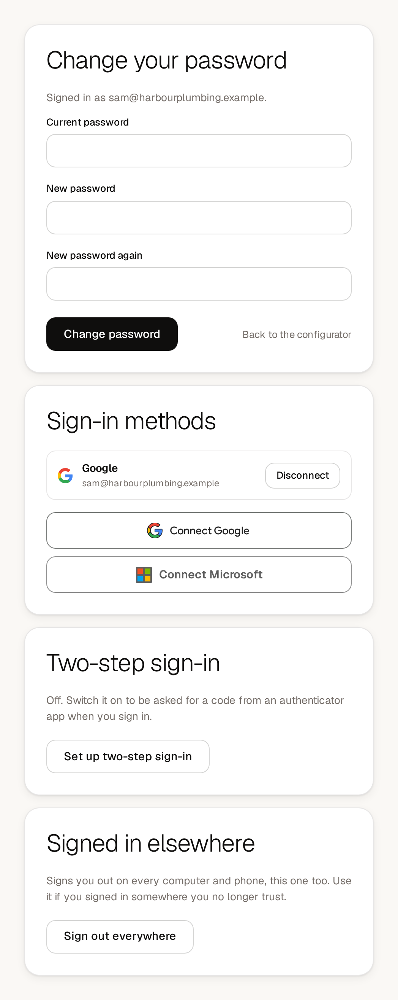
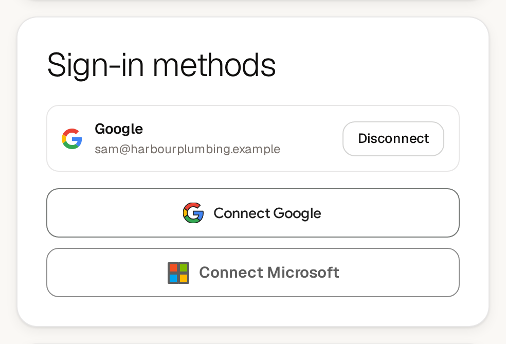

Your account page is where you look after how you sign in: your password, any Google or Microsoft account you sign in with, two-step sign-in, and signing out on other computers. Only you can see it and change it.

To open it, click your email address at the bottom of the side menu. If you are on the **Choose a workspace** page, click **Change password**.

<Frame>
  
</Frame>

The page has four parts:

| What you see | What it is for |
|---|---|
| **Change your password** | Choose a new password. |
| **Sign-in methods** | The Google or Microsoft accounts you can sign in with. |
| **Two-step sign-in** | Ask for a code from your phone each time you sign in. See [Two-step sign-in](/account/two-step-sign-in). |
| **Signed in elsewhere** | Sign out on every computer and phone at once. |

## Change your password

<Steps>
  <Step title="Type your current password">
    In **Current password**, type the password you use now.
  </Step>
  <Step title="Type the new password twice">
    Type it in **New password** and again in **New password again**. It must be at least 12 characters.
  </Step>
  <Step title="Click Change password">
    The page says: "Your password has been changed. You have been signed out everywhere else."
  </Step>
</Steps>

You stay signed in on the computer you are using. Every other computer and phone where you were signed in is signed out, even where **Keep me signed in on this computer** was ticked. An email with the subject **Your password was changed** is sent to your address.

To go back to your workspace, click **Back to the configurator**.

### The password rules

- It must be at least 12 characters.
- A password that is known to have leaked from another website may be refused.

### What can go wrong

| What you see | What to do |
|---|---|
| "That is not your current password." | Type the password you use now in **Current password**. If you have forgotten it, sign out and use **Forgot your password?** on the sign-in page. See [Sign in](/get-started/sign-in#forgot-your-password). |
| "The two new passwords are not the same." | Type the same new password in both boxes. |
| "The password field must be at least 12 characters." | Choose a longer password. |
| "The given password has appeared in a data leak. Please choose a different password." | This password is known to have leaked from another website. Choose a different one. |

### If you have never chosen a password

If you accepted your invitation with Google or Microsoft, you may never have chosen a password. The page then says: "You have not chosen a password yet. To choose one, sign out and use “Forgot your password?” on the sign-in page."

## Google and Microsoft

The **Sign-in methods** card lists each Google or Microsoft account connected to you, with the address it gave. When none is connected it says: "No Google or Microsoft account is connected. You sign in with your email address and password."

The **Connect Google** and **Connect Microsoft** buttons show only where signing in with Google or Microsoft is offered. If you see neither, you sign in with your email address and password only.

<Frame>
  
</Frame>

### Connect Google or Microsoft

<Steps>
  <Step title="Click Connect Google or Connect Microsoft">
    You may first be asked to confirm it is you. Do that, then click the button again. See [Confirm it is you](/account/confirm-it-is-you).
  </Step>
  <Step title="Sign in on Google's or Microsoft's page">
    Use the account you want to sign in with.
  </Step>
  <Step title="Come back to your account page">
    It says, for example, "Google is connected. You can now sign in with it."
  </Step>
</Steps>

From now on you can click **Continue with Google** or **Continue with Microsoft** on the sign-in page. An email is sent to your address each time a sign-in is connected or disconnected.

### Disconnect one

Click **Disconnect** beside it, confirming it is you if asked. The page says: "Disconnected. It can no longer be used to sign in."

You cannot disconnect your only way in. If you have no password of your own and this is your only connected account, the page says, for example, "This is your only way to sign in, so Google cannot be disconnected. Connect another sign-in first." Either connect another account, or choose a password (sign out and use **Forgot your password?**). Then disconnect it.

| What you see | What it means |
|---|---|
| "That Google account is already used to sign in to another account, so it was not connected." | Someone else's My Receptionist account uses that Google account. Connect a different one. The same applies to Microsoft. |
| "Connecting Google did not work. Try again." | You cancelled, or something went wrong on the way. Try again. |

## Signing out everywhere

The **Signed in elsewhere** card has one button: **Sign out everywhere**. It "Signs you out on every computer and phone, this one too. Use it if you signed in somewhere you no longer trust."

<Steps>
  <Step title="Click Sign out everywhere">
    You may first be asked to confirm it is you. Do that, then click it again.
  </Step>
  <Step title="Sign in again">
    You land on the sign-in page, which says: "You have been signed out everywhere, here too."
  </Step>
</Steps>

Use it if you signed in on a shared computer and forgot to sign out, or if you think someone else knows your password. In that case, change your password as well.

## Common questions

<AccordionGroup>
  <Accordion title="Can the workspace owner change my password for me?">
    No. Nobody types a password for someone else. If you have forgotten yours, use **Forgot your password?** on the sign-in page.
  </Accordion>
  <Accordion title="I got an email saying my password was changed, but I did not change it.">
    Reset your password straight away with **Forgot your password?** on the sign-in page. Then check the **Sign-in methods** card and disconnect any Google or Microsoft account you do not recognise.
  </Accordion>
  <Accordion title="Does changing my password affect my receptionist?">
    No. It only changes how you sign in.
  </Accordion>
</AccordionGroup>
