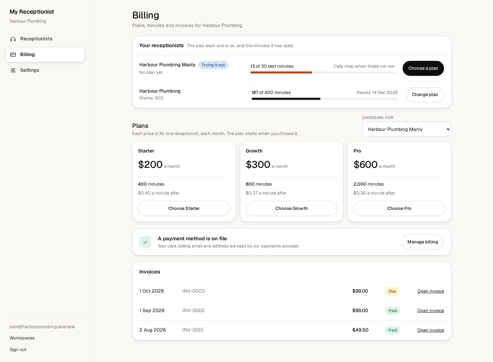
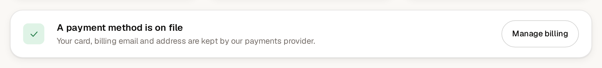
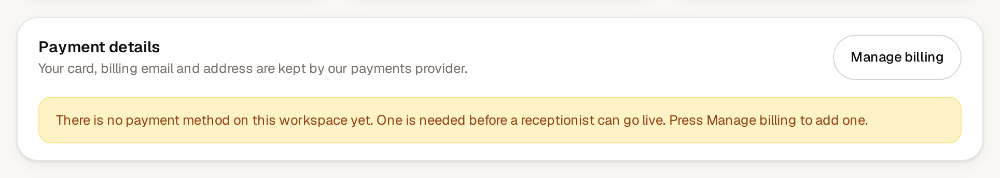
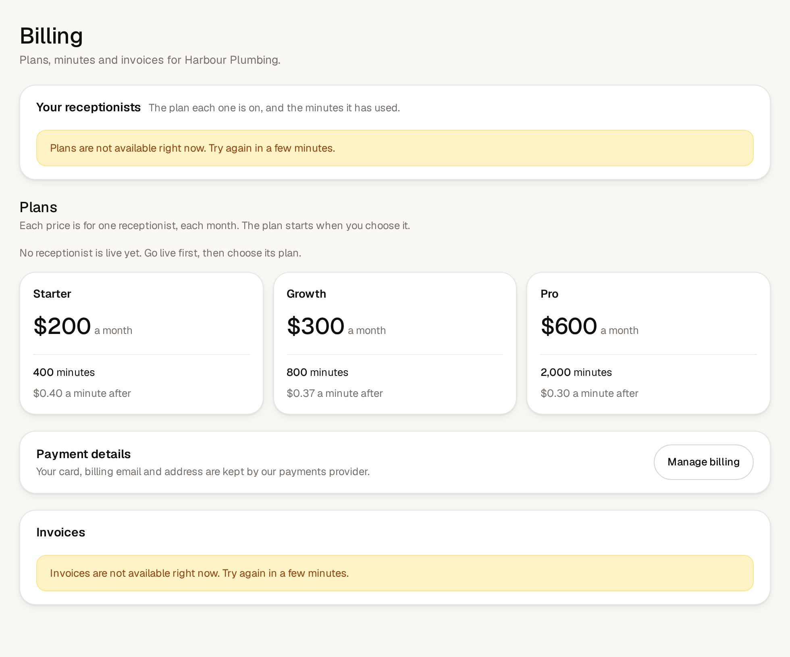

The **Billing** page is where you pay for your receptionists. It shows the plan each receptionist is on and the minutes it has used. You also manage your card and billing details there, and open your invoices.

<Frame>
  
</Frame>

<Note>
The plan names, prices and minutes in the pictures on this page are examples. Your **Billing** page shows the real ones.
</Note>

## Who can see it

Only an **Owner** of the workspace can see the **Billing** page. It appears in the side menu for owners only. If someone with the **Staff** or **Customer** role opens its address, they see "There is nothing at this address." See [People and roles](/workspace/people-and-roles) for what each role can do.

## What is on the page

The page has these parts, from top to bottom.

| What you see | What it shows |
|---|---|
| **Your receptionists** | Each receptionist that has gone live, the plan it is on, and the minutes it has used. See [Plans and minutes](/billing/plans-and-minutes). |
| **Plans** | The plans you can choose, shown as cards. Each card shows its price, the minutes it includes and the price of each minute after them. |
| **Payment details** | Where your card and billing details are kept, and the **Manage billing** button. |
| **Invoices** | Your invoices, newest first. |

The prices and minutes for each plan are shown on the page itself. They can change, so this help site does not list them.

## Payment details and Manage billing

The **Payment details** card says: "Your card, billing email and address are kept by our payments provider." My Receptionist does not keep your card details itself.

When a payment method has been added, the card's heading changes to **A payment method is on file**, with a tick beside it.

To add or change your card, billing email or address:

<Steps>
  <Step title="Open Billing">
    In the side menu, click **Billing**.
  </Step>
  <Step title="Press Manage billing">
    In the **Payment details** card, click **Manage billing**. A separate, secure payments page opens in a new browser tab.
  </Step>
  <Step title="Make your changes there">
    Your card, billing email and address are kept on that payments page. Make your changes there. Your My Receptionist tab stays open where it was.
  </Step>
</Steps>

<Frame>
  
</Frame>

## Why a payment method is needed

A receptionist cannot go live until the workspace has a payment method. If there is none, the **Payment details** card shows this message:

"There is no payment method on this workspace yet. One is needed before a receptionist can go live. Press Manage billing to add one."

<Frame>
  
</Frame>

If someone presses **Go live** before a payment method has been added, nothing is changed and they are told to add one in **Billing** first. A person who is not an owner is told to ask the owner of the workspace to add one. See [Go live](/receptionist/go-live).

A payment method is also needed before the owner can get a new phone number. When you get one, the page says it "is added to this workspace and charged with your plan." See [Voice and number](/receptionist/voice-and-number).

## Invoices

The **Invoices** card lists your invoices, newest first, ten to a page. Each line shows:

- the date of the invoice
- the invoice number
- the amount
- its status
- an **Open invoice** link

The status is one of **Paid**, **Due**, **Draft**, **Cancelled** or **Not paid**. **Paid** is shown in green, **Due** in amber and **Not paid** in red.

To open an invoice, click **Open invoice** on its line. It opens in a new browser tab on the payments page, where you can see it in full.

If you have more than ten invoices, click **Older** under the list to see the next ten. Click **Newest** to go back to the most recent ones.

If you have none yet, the card says "No invoices yet."

Dates on the Billing page are shown as they fall in Australia's eastern states.

## When billing cannot be shown

Sometimes part of the Billing page cannot be shown for a moment. That part shows a short message, and the rest of the page still works.

| Message | What to do |
|---|---|
| "Invoices are not available right now. Try again in a few minutes." | Reload the page in a few minutes. |
| "Plans are not available right now. Try again in a few minutes." | Reload the page in a few minutes. |
| **Could not check right now**, in place of a receptionist's plan | Reload the page in a few minutes. |
| "Billing is not available right now." (after pressing **Manage billing**) | The payments page could not be opened. Try again later. If it keeps happening, contact support. |

<Frame>
  
</Frame>

## Common questions

<AccordionGroup>
  <Accordion title="I am on the Staff role. Why can't I see Billing?">
    Only an Owner can see the Billing page. Ask an owner of your workspace to check billing, or to change your role on the [People](/workspace/people-and-roles) page.
  </Accordion>
  <Accordion title="Where do I change my card?">
    Press **Manage billing** on the Billing page. Your card is changed on the payments page that opens.
  </Accordion>
  <Accordion title="How do I cancel a plan?">
    There is no cancel button on the Billing page. Press **Manage billing** and cancel on the payments page. See [Plans and minutes](/billing/plans-and-minutes).
  </Accordion>
  <Accordion title="The card says Payment details, with no message about a payment method. Is one on file?">
    Sometimes the page cannot tell. It then shows **Payment details** with no message either way. Press **Manage billing** to check on the payments page.
  </Accordion>
</AccordionGroup>

<CardGroup cols={2}>
  <Card title="Plans and minutes" href="/billing/plans-and-minutes">
    Put a receptionist on a plan and follow its minutes.
  </Card>
  <Card title="Test minutes" href="/billing/test-minutes">
    What happens before a receptionist is on a plan.
  </Card>
</CardGroup>
