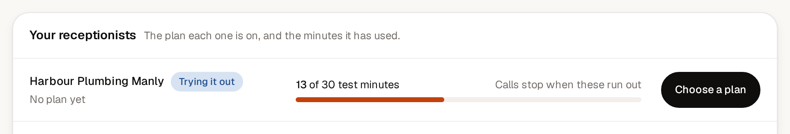
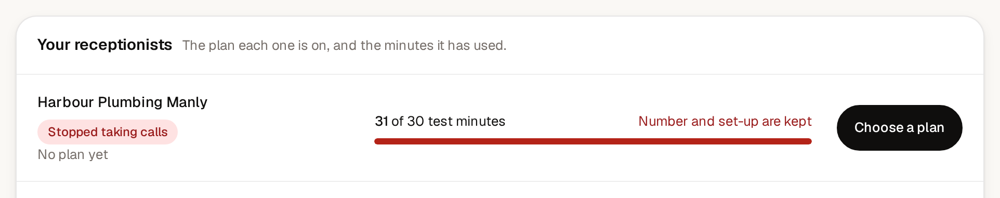

A receptionist that has gone live but is not on a plan yet may come with free test minutes. They let you ring it, hear how it answers, and try putting calls through before you pay for a plan. When the test minutes are used up, the receptionist stops answering calls until you choose a plan for it.

Test minutes are shown only on the **Billing** page, which only an **Owner** of the workspace can see. See [Billing](/billing/overview).

## Where they show

On the Billing page, under **Your receptionists**, a receptionist using test minutes has a blue **Trying it out** tag beside its name, and **No plan yet** under it.

Beside it, a thin bar shows how many test minutes it has used, out of how many it has. It reads like this: the minutes used, "of", the minutes it has, then **test minutes**. The number of test minutes is shown on the page.

Under the figure is one short line:

| What you see | What it means |
|---|---|
| **Calls stop when these run out** | The receptionist still has test minutes left. |
| **All used. Calls stop shortly** | The test minutes are used. The receptionist will stop answering calls soon. |

<Frame>
  
</Frame>

<Note>
The plan names, prices and minutes in the pictures on this page are examples. Your **Billing** page shows the real ones.
</Note>

Test minutes are for the life of the receptionist. They do not start again each month.

Part of a minute counts as a whole minute.

## When the test minutes are used

When a receptionist on no plan has used its test minutes, it stops answering calls. The Billing page then shows a red **Stopped taking calls** tag beside its name, and the line **Number and set-up are kept**.

That means:

- the receptionist keeps its phone number
- everything you set up for it is kept: its people and teams, opening hours, wording and knowledge
- callers who ring the number are not answered by it until it is on a plan

<Frame>
  
</Frame>

<Note>
The **Stopped taking calls** tag shows only on the Billing page. The receptionist's own page and the list of receptionists do not say it has stopped, and no email is sent. If calls to a receptionist that is not on a plan stop being answered, look at the Billing page first.
</Note>

## Why it can go past its test minutes

A call is not counted the moment it ends. So the receptionist is not stopped at the exact moment its test minutes run out. It keeps answering calls until the count catches up, and may use a few more minutes than it was given.

For the same reason, the figure on the Billing page may not include a call that has only just ended.

## Start taking calls again

To start a stopped receptionist answering calls again, put it on a plan.

<Steps>
  <Step title="Add a payment method">
    If the workspace has no payment method yet, press **Manage billing** on the Billing page and add one. See [Billing](/billing/overview).
  </Step>
  <Step title="Choose a plan">
    Under **Your receptionists**, click **Choose a plan** beside the stopped receptionist, then click **Choose** on the plan you want.
  </Step>
  <Step title="Confirm">
    Confirm in the box your browser shows. The plan starts straight away and the receptionist is put back on its number.
  </Step>
</Steps>

You do not need to press **Go live** again. Its number and set-up were kept.

See [Plans and minutes](/billing/plans-and-minutes) for choosing a plan step by step, and for the messages you may see if it cannot be set.

## Common questions

<AccordionGroup>
  <Accordion title="Do my test minutes come back next month?">
    No. Test minutes are for the life of the receptionist.
  </Accordion>
  <Accordion title="Will I lose my phone number when the test minutes run out?">
    No. The Billing page says **Number and set-up are kept**. Choose a plan and the receptionist answers on the same number.
  </Accordion>
  <Accordion title="Can I add more test minutes?">
    The Billing page has no way to add test minutes. Choose a plan to keep the receptionist answering.
  </Accordion>
  <Accordion title="Why can't my Staff see that the receptionist has stopped?">
    Only an Owner can see the Billing page, and that is the only place that says so.
  </Accordion>
</AccordionGroup>
