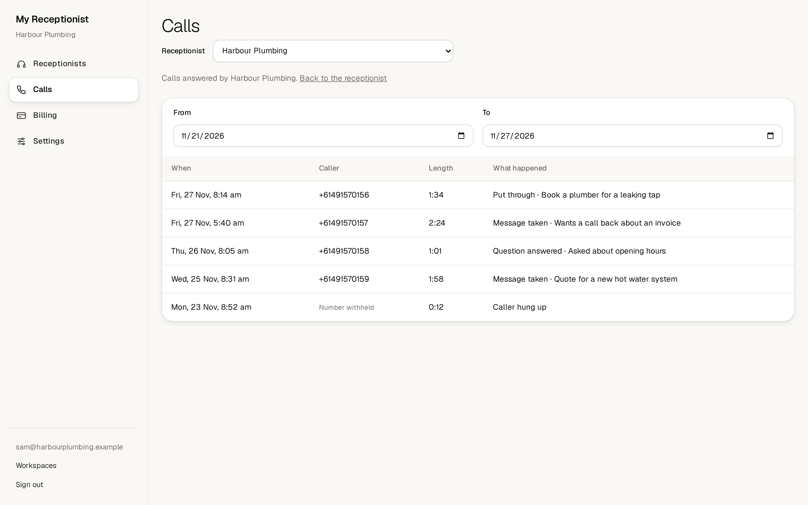
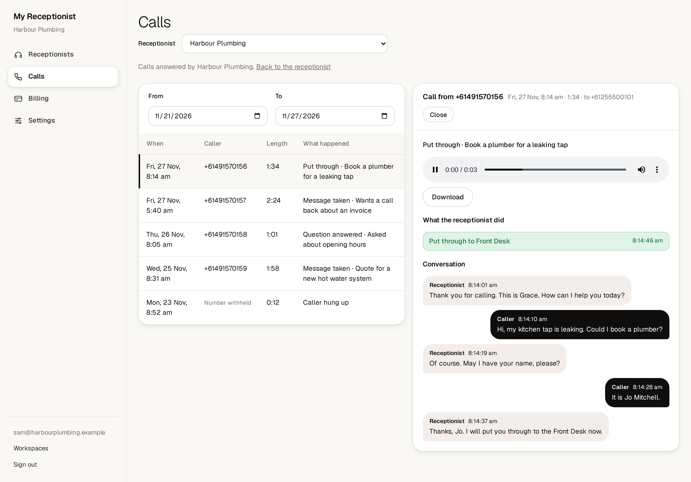

The **Calls** page shows the calls a receptionist has answered: when each call came in, who rang, how long it lasted and what happened. You can open any call to read the conversation, see what the receptionist did and play the recording.

<Frame>
  
</Frame>

## Open the Calls page

There are three ways in:

- Click **Calls** in the side menu, then choose a receptionist from the **Receptionist** list at the top.
- On your list of receptionists, open a receptionist's menu and click **Calls**.
- On a receptionist's page, click **Calls** at the top.

Once a receptionist is chosen, the page says "Calls answered by" and the receptionist's name, with a **Back to the receptionist** link. To see another receptionist's calls, choose it from the **Receptionist** list.

If the **Calls** link is not there at all, call history has not been set up for your workspace. Contact support.

## The list of calls

The list shows the calls between the two dates in **From** and **To**, newest first. At first it shows the last 7 days, including today. Change either date to see other days. The list can cover up to a year at a time, and **To** cannot be later than today.

Dates and times are in the receptionist's timezone, the **Timezone** on the [Your business](/receptionist/your-business) card.

The list shows 20 calls at a time. When there are more, the bottom of the list says "Page 1 of 3" and so on. Click **Older** for earlier calls and **Newer** to go back.

| Column | What it shows |
|---|---|
| **When** | The day, date and time the call started, for example "Thu, 26 Nov, 4:14 pm". "Time not known" if there is no start time. |
| **Caller** | The number the caller rang from. "Number withheld" if they hid it. |
| **Length** | How long the call lasted, in minutes and seconds. "1:34" is one minute and 34 seconds. |
| **What happened** | How the call ended up, and the reason for the call when there is one, for example "Message taken · Wants a call back about an invoice". |

### What happened

The first part of **What happened** is one of these:

| What it says | What it means |
|---|---|
| Put through | The caller was put through to someone. |
| Could not be put through | The receptionist tried to put the call through, but it did not work. |
| Message taken | The receptionist took a message. |
| Question answered | The caller asked a question and the receptionist answered it. |
| Caller hung up | The caller hung up. |
| Went to voicemail | The call went to voicemail. |
| Office closed | The call came in while the office was closed. |
| Unwanted call | The call looked like a nuisance call. |
| Caller said nothing | Nobody spoke on the call. |
| Something went wrong on the call | There was a problem on the call. |

Now and then you may see another short description in plain words. The second part, after the dot, is the reason for the call in a few words. It is not always there.

## Open a call

Click a call in the list. It opens beside the list, or below it on a small screen. Click **Close** to put it away.

<Frame>
  
</Frame>

At the top you see "Call from" and the caller's number, then the date and time, the length, and "to" the number they rang. Below that:

- **What happened**, as in the list.
- **The recording.** Click **Play recording** to listen or **Download** to save a copy. See [Call recording](/on-a-call/call-recording).
- **What the receptionist did.** A list of the steps it took, each with the time. For example:
  - "Put through to Service", or "Could not put the call through to Service"
  - "Put through to a member of the team"
  - "Message sent to Dr Patel by email", or "Message sent by text"
  - "The message could not be sent by email", or "The message could not be sent by text"
  - "Looked up the answer in the knowledge base"
  - "Call ended"
- **Conversation.** Everything said on the call, in order. Each line is marked **Receptionist** or **Caller**, with the time it was said. If nobody spoke, it says "Nothing was said on this call."

## Who can see calls

Anyone who can sign in to your workspace and see a receptionist can see its calls, read its conversations and play its recordings. Someone who can see only some receptionists sees only those receptionists in the **Receptionist** list. See [Access and locks](/workspace/access-and-locks).

## Messages you may see

| Message | What it means and what to do |
|---|---|
| No calls yet. Calls appear here once your receptionist is live. | The receptionist has never gone live. See [Go live](/receptionist/go-live). |
| No calls between these dates. | Nothing came in between **From** and **To**. Choose other dates. |
| There are no receptionists here yet. | Your workspace has no receptionists, or none you can see. |
| Call history is not available right now. Try again in a few minutes. | The call history could not be fetched. Wait a few minutes and reload the page. |
| Something went wrong. Try again in a few minutes. | Something unexpected went wrong. Wait a few minutes and try again. |
| Choose at most a year at a time. | The dates are more than a year apart. Move them closer. |
| The first date must be on or before the second. | **From** is after **To**. Swap them. |
| Choose the dates again: one of them is not a date. | Pick both dates again from the date boxes. |
| The link to the recording ran out. Press Play recording again. | The recording was open too long. Click **Play recording** again. |

## Common questions

<AccordionGroup>
  <Accordion title="Why does the Caller column say Number withheld?">
    The caller hid their number. When the receptionist takes a message, it always asks for a number to call back on, and it does not take the message without one. So a message from that caller still has a number, in the message and in the conversation.
  </Accordion>
  <Accordion title="Can I search for a caller's number?">
    No. You can only choose the dates. Open a call to see its details.
  </Accordion>
  <Accordion title="Why is there no recording for a call?">
    The call shows the reason under **No recording for this call.** See [Call recording](/on-a-call/call-recording).
  </Accordion>
</AccordionGroup>
