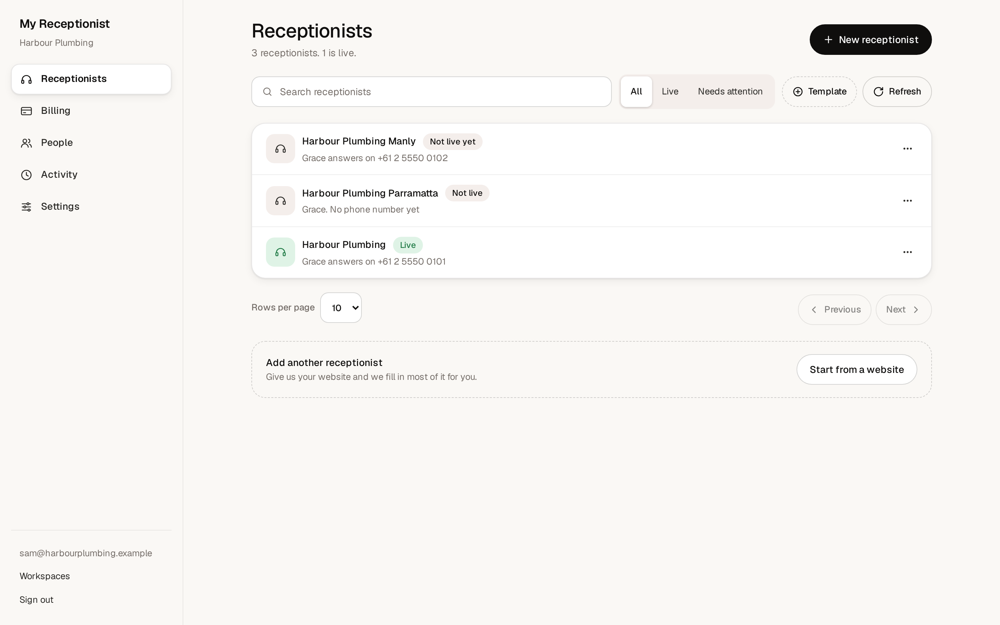
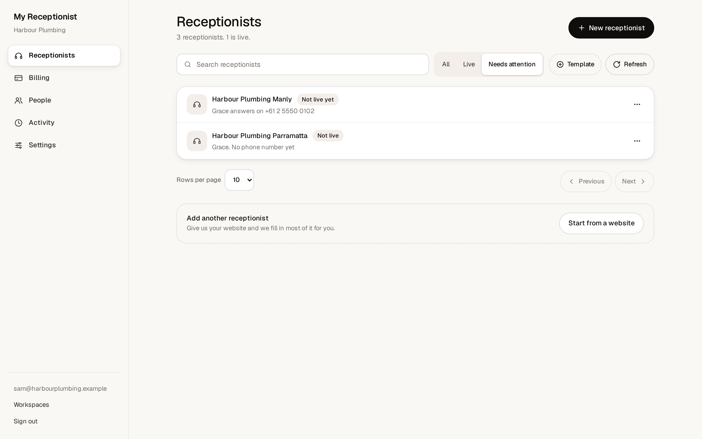
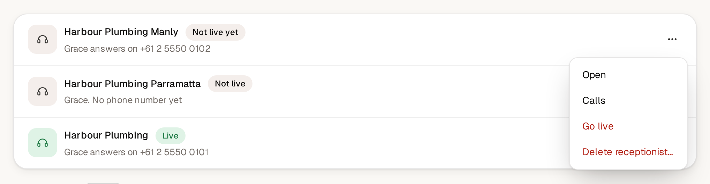
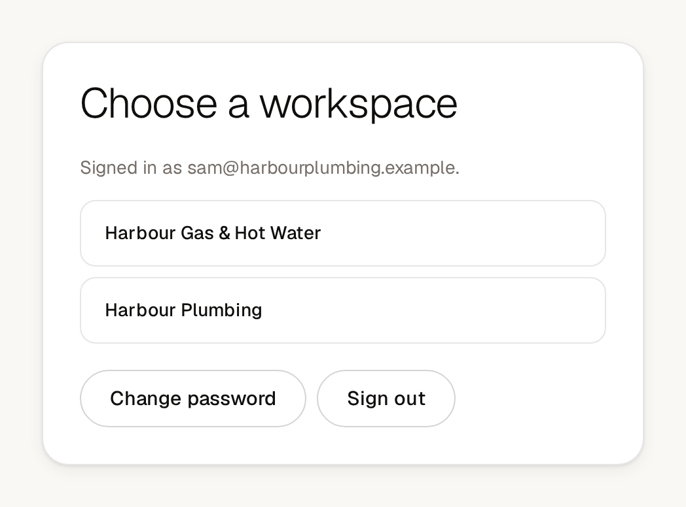

After you sign in, you start from two places: the side menu on the left, and the list of receptionists in the middle. This page explains each part.

<Frame>
  
</Frame>

## The side menu

The top of the side menu shows **My Receptionist** and, under it, your workspace's name. If the workspace's owner has set a brand name or logo, it shows in place of **My Receptionist**. See [Branding](/workspace/branding).

Each item opens a page:

| What you see | What it is for |
|---|---|
| **Receptionists** | The list of your receptionists. Click one to change how it answers calls. |
| **Calls** | Your call history: who rang, when, and what was said. Shown only where call history is set up. See [Call history](/calls/call-history). |
| **Billing** | Your plan, minutes used, payment method and invoices. See [Billing](/billing/overview). |
| **People** | The people who can sign in to this workspace. See [People and roles](/workspace/people-and-roles). |
| **Activity** | A record of who changed what, and when. See [Activity](/workspace/activity). |
| **Settings** | The name or logo at the top of each page, and the colour of the main buttons. See [Branding](/workspace/branding). |

You see only the items you are allowed to open. **Billing**, **People**, **Activity** and **Settings** are for the workspace's owner. Other people see **Receptionists**, and **Calls** where it is set up. See [People and roles](/workspace/people-and-roles).

<Note>
**People** in the side menu is the list of people who can sign in. It is not the same as **People and teams** on a receptionist's page, which is the list of people callers can be put through to.
</Note>

At the bottom of the side menu:

- **Your email address** opens your account page, where you change your password and set up two-step sign-in. See [Your password](/account/password).
- **Workspaces** takes you back to the list of your workspaces. It shows only if you belong to more than one.
- **Sign out** signs you out.

On a phone or a narrow window, the side menu becomes a bar across the top. Click **Menu** to open it.

## The list of receptionists

The **Receptionists** page lists every receptionist in the workspace that you can see. Under the heading a line counts them, for example "3 receptionists. 1 is live."

Each row shows:

- the receptionist's name, as it is called in your list;
- a tag saying where it stands (see below);
- under the name, the name it gives callers and the number callers ring, for example "Ava answers on" and the number. If it has no number yet, the line says "No phone number yet".

Click anywhere on a row to open that receptionist's page. See [The receptionist's page](/receptionist/the-receptionist-page).

### What the tags mean

| Tag | What it means |
|---|---|
| **Live** | It is answering calls. Callers hear the version that last went live. |
| **Not live yet** | It has been prepared for going live, but it is not answering calls yet. |
| **Not live** | It has never gone live. It is not answering calls. |
| **Deleted** | It was deleted outside this list, so it no longer answers calls. It stays in the list until you delete it here too. |

For how to make a receptionist live, see [Go live](/receptionist/go-live).

### Finding a receptionist

- **Search receptionists**: type part of a receptionist's name to show only the ones that match.
- **All**, **Live** and **Needs attention**: click one to show every receptionist, only the live ones, or only the ones that are not live.
- **Refresh**: loads the list again, for example after someone else has made a change.

<Frame>
  
</Frame>

Deleted receptionists are hidden. When there are some, a line under the list says how many, with **show** to list them and **hide** to put them away again.

### The menu on each row

Click the **⋯** button at the right of a row to open its menu:

| What you see | What it does |
|---|---|
| **Open** | Opens the receptionist's page. |
| **Calls** | Opens this receptionist's call history. Shown only where call history is set up. |
| **Go live** | Makes the receptionist live, as the **Go live** button on its page does. Shown to the owner and staff, and to a Customer who is allowed to go live. Staff who are not allowed are told so when they press it. |
| **Delete receptionist…** | Deletes the receptionist, after asking you to confirm. Shown only to the owner and staff. Staff can delete a receptionist that has gone live only if they are allowed to publish and delete. |

<Frame>
  
</Frame>

### Adding a receptionist

If you are allowed to add receptionists, you see a **New receptionist** button at the top right, and a box under the list: **Add your first receptionist** or **Add another receptionist**. See [Make a receptionist](/receptionist/create).

## Choosing a workspace

Most people belong to one workspace, and it opens as soon as they sign in.

If you belong to more than one, the page **Choose a workspace** opens after you sign in. It lists your workspaces by name. Click one to open it. The page also has **Change password** and **Sign out**.

To change to another workspace later, click **Workspaces** at the bottom of the side menu. See [Belonging to several workspaces](/workspace/several-workspaces).

<Frame>
  
</Frame>

## Signing out

Click **Sign out** at the bottom of the side menu. You are signed out on this computer only.

To sign out on every computer and phone at once, use **Sign out everywhere** on your account page. See [Your password](/account/password#signing-out-everywhere).

## Common questions

<AccordionGroup>
  <Accordion title="Why can't I see Billing or People in my menu?">
    Those pages are for the workspace's owner. If you need something there, ask the owner. See [People and roles](/workspace/people-and-roles).
  </Accordion>
  <Accordion title="Why don't I see every receptionist in the workspace?">
    Some people are given only certain receptionists. See [Access and locks](/workspace/access-and-locks).
  </Accordion>
  <Accordion title="Why is there no New receptionist button?">
    Not everyone may add receptionists. Ask the workspace's owner. See [People and roles](/workspace/people-and-roles).
  </Accordion>
  <Accordion title="What does Needs attention show?">
    Every receptionist that is not live, whatever the reason. Open one to see what it still needs. Its **Go live** box lists anything still to fix.
  </Accordion>
</AccordionGroup>
