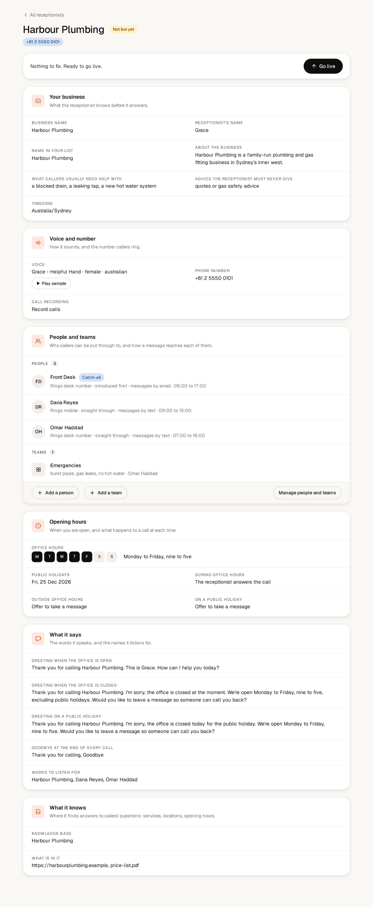
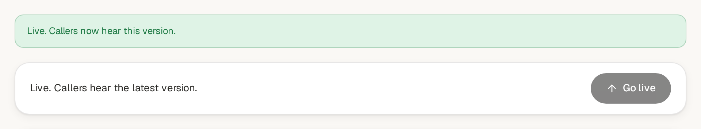

This page takes you from nothing to a receptionist that answers when someone rings your number. Each step links to a page with more detail.

<Frame>
  
</Frame>

<Steps>
  <Step title="Sign up">
    On the sign-in page, click **Create your account**. Type your **Business name** and **Email address**, then click **Email me a link**. Open the email, click **Choose your password**, and choose a password of at least 12 characters. Your workspace is set up in a few seconds.

    If your sign-in page has no **Create your account** link, someone has to add you instead. See [Sign up](/get-started/sign-up).
  </Step>
  <Step title="Make a receptionist">
    On the **Receptionists** page, click **New receptionist**.

    If the box asks for your **Business website**, type it and click **Read the website**. My Receptionist reads your website's public pages and fills in what it can. This takes up to a minute or two.

    If there is no website box, or you click **Set it up by hand**, type your business name as callers will hear it, then click **Create**.

    See [Make a receptionist](/receptionist/create).
  </Step>
  <Step title="Check what was filled in">
    The receptionist's page has six cards: **Your business**, **Voice and number**, **People and teams**, **Opening hours**, **What it says** and **What it knows**. Click a row to change it. Changes save by themselves.

    If you started from your website, check everything it filled in, especially the phone numbers and email addresses in **People and teams**: they decide where calls and messages go. See [The receptionist's page](/receptionist/the-receptionist-page).
  </Step>
  <Step title="Add the people callers ask for">
    In **People and teams**, add each person or team callers can be put through to, with their phone number and email address. See [People and teams](/receptionist/people-and-teams).
  </Step>
  <Step title="Set your opening hours">
    In **Opening hours**, choose the days and times you are open. Calls are only put through during these hours. Outside them, the receptionist says the office is closed and, unless you choose otherwise, offers to take a message. See [Opening hours](/receptionist/opening-hours).
  </Step>
  <Step title="Choose a phone number">
    In **Voice and number**, open **Phone number** and choose a number from the list. If there is none, the workspace's owner can click **Get a new number**. The number is connected when you go live. See [Voice and number](/receptionist/voice-and-number).
  </Step>
  <Step title="Fix anything the page lists">
    The **Go live** box, above the cards, lists anything still to fix. Click a line to go straight to it. When nothing is left, it says "Nothing to fix. Ready to go live." See [Things to fix](/receptionist/things-to-fix).
  </Step>
  <Step title="Go live">
    Click **Go live** and confirm. When it is done, the page says "Live. Callers now hear this version."

    If the page says a payment method is needed first, the workspace's owner adds one on the **Billing** page, then you click **Go live** again. See [Go live](/receptionist/go-live) and [Billing](/billing/overview).
  </Step>
  <Step title="Ring your number">
    Ring the receptionist's number from your own phone and ask for one of your people. If **Calls** is in your side menu, your test call shows there. See [Call history](/calls/call-history).
  </Step>
</Steps>

<Frame>
  
</Frame>

## After you go live

- To change something, change it on the receptionist's page, then click **Publish changes** in the **Go live** box. Callers keep hearing the old version until you do.
- To let a colleague help, add them on the **People** tab of **Settings**. See [People and roles](/workspace/people-and-roles).
- To learn what callers hear, read [How a call goes](/on-a-call/how-a-call-goes).
- A receptionist that is not on a plan yet may have free test minutes. When they run out, it stops answering until you choose a plan. See [Test minutes](/billing/test-minutes) and [Plans and minutes](/billing/plans-and-minutes).

## Common questions

<AccordionGroup>
  <Accordion title="Do I have to finish everything in one go?">
    No. Changes save by themselves, so you can stop and come back. Nothing reaches callers until you click **Go live**.
  </Accordion>
  <Accordion title="Can I keep my existing business number?">
    The **Phone number** list shows the numbers in your workspace that are free. If you cannot find the number you want, contact support.
  </Accordion>
  <Accordion title="I cannot see the Go live button.">
    If you have the **Customer** role and are not allowed to go live, the **Go live** box shows "Your changes are saved. Someone who is allowed to go live needs to press Go live." in place of the button. Ask the workspace's owner. See [People and roles](/workspace/people-and-roles).
  </Accordion>
  <Accordion title="I pressed Go live and it said I am not allowed.">
    The message is "Your changes are saved, but your account is not allowed to make them live. Ask someone who can go live to press Go live." Your changes are kept. Ask the workspace's owner to press **Go live**, or to let you do it.
  </Accordion>
</AccordionGroup>
