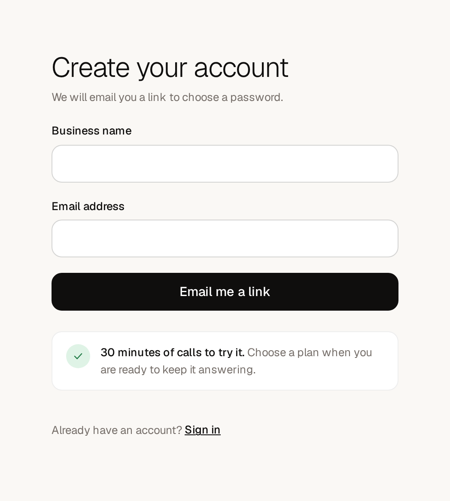
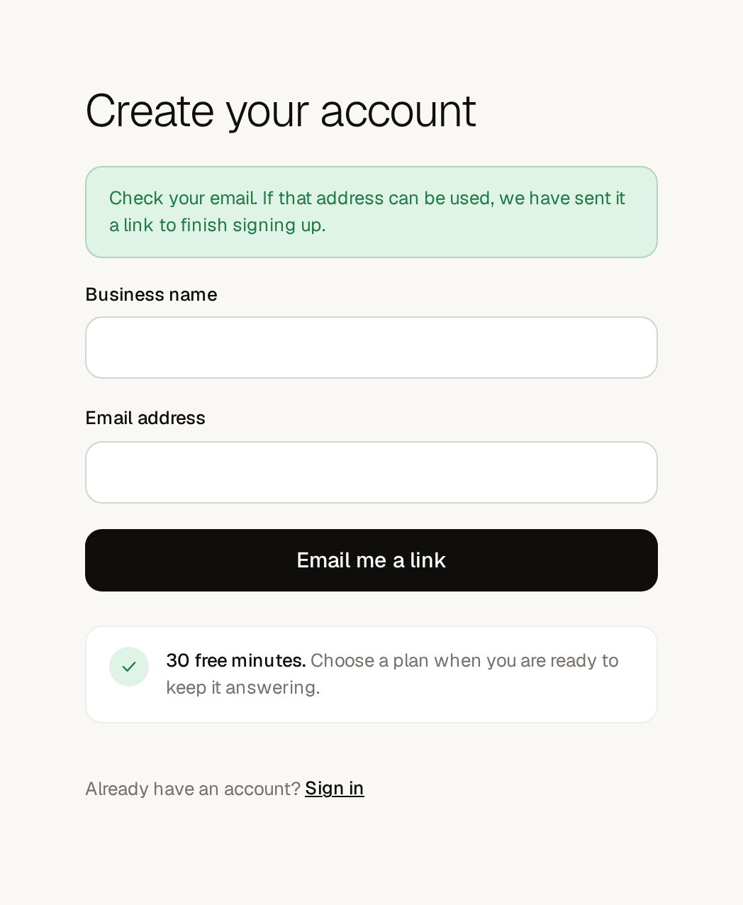
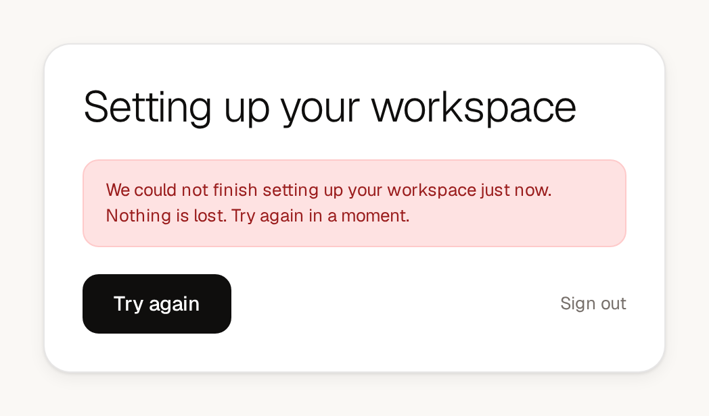

Signing up gives your business its own workspace. That is where you set up the receptionist that answers your calls. You need your business's name and an email address. It takes a few minutes.

<Note>
Signing up by yourself is not offered everywhere. If your sign-in page shows **New here? Create your account**, you can sign up. If it does not, someone has to add you instead: ask whoever runs My Receptionist for your business, then follow the link in the email they send. See [Sign in](/get-started/sign-in#accepting-an-invitation).
</Note>

<Frame>
  
</Frame>

## Sign up

<Steps>
  <Step title="Open the sign-up page">
    On the sign-in page, under the **Sign in** button, click **Create your account**.
  </Step>
  <Step title="Type your business name">
    In **Business name**, type your business's name, for example "Harbour Dental". This becomes the name of your workspace. It can be up to 100 characters, on one line. Use only letters, numbers, spaces and these marks: & ' . , - + ! ? It must not look like a web or email address, so type "Harbour Dental", not "harbourdental.com.au".
  </Step>
  <Step title="Type your email address">
    In **Email address**, type the address you want to sign in with. Use one you can open now: the next step happens in your email.
  </Step>
  <Step title="Ask for the link">
    Click **Email me a link**. The page says: "Check your email. If that address can be used, we have sent it a link to finish signing up."
  </Step>
  <Step title="Open the email">
    Look for an email with the subject **Finish setting up My Receptionist**. Click **Choose your password** in it.
  </Step>
  <Step title="Choose your password">
    The page **Choose your password** opens, with your email address filled in. Type a password of at least 12 characters in **Password**, type it again in **Password again**, then click **Save the password and sign in**.

    If the page also shows **Continue with Google** or **Continue with Microsoft**, you can use that account instead of choosing a password. It must be the account for the same email address.
  </Step>
  <Step title="Wait while your workspace is set up">
    The page **Setting up your workspace** opens and says "Setting up" with your business name. This takes a few seconds. When it is done, you land on your new workspace's **Receptionists** page.
  </Step>
</Steps>

<Frame>
  
</Frame>

You are the **owner** of the new workspace. The owner can see **Billing** and **Settings** in the side menu, and can add other people on the **People** tab of **Settings**. See [People and roles](/workspace/people-and-roles).

Next, make your first receptionist. See [Make a receptionist](/receptionist/create), or follow the [Quickstart](/get-started/quickstart).

## About the emailed link

- The link works **once**, for **7 days**.
- If you sign up again with the same address before you use the link, a fresh link is sent and the earlier one stops working.
- At most 3 sign-up emails a day go to one address. After that the page still says "Check your email", but no email is sent until the next day.
- If your address already has an account, the page says the same thing, but the email you get says **You already have a My Receptionist account**, with a **Sign in** button. Nothing is changed. Sign in as usual, or use **Forgot your password?**.

The page shows the same words for every address on purpose. That way nobody can use it to find out who has an account.

## What can go wrong

| What you see | What to do |
|---|---|
| "Type the name of your business." | The **Business name** box is empty. Type your business's name. |
| "The name can be at most 100 characters." | Shorten the business name. |
| "The name must be on one line." | Take out any line breaks in the business name. |
| "Use only letters, numbers, spaces and these marks in the name: & ' . , - + ! ?" | Take out any other marks, such as brackets, slashes or @. |
| "The name cannot look like a web or email address." | Type your business's name without its web address. |
| "Type your email address." | The **Email address** box is empty. |
| "That does not look like an email address." | Check the address for typing mistakes. |
| "That email address is too long." | Use a shorter email address. |
| No email arrives | Wait a few minutes and check your junk or spam folder. Check you typed the address correctly, then sign up again to get a fresh link. |
| "This link no longer works" | The link has been used already, or more than 7 days have passed. Sign up again with the same address to get a new link. If you already chose a password, sign in instead. |
| "We could not finish setting up your workspace just now. Nothing is lost. Try again in a moment." | Wait a moment, then click **Try again**. Your account and password are kept. |

<Frame>
  
</Frame>

If setting up your workspace does not finish, you can also click **Sign out** on that page and come back later. When you sign in again, the **Setting up your workspace** page opens and offers **Try again**.

## Common questions

<AccordionGroup>
  <Accordion title="Do I need a card to sign up?">
    No. You only give your business name and email address. A payment method is needed later, before your receptionist can go live. You add it on the **Billing** page. See [Billing](/billing/overview).
  </Accordion>
  <Accordion title="Can I sign up with Google or Microsoft?">
    Not on the sign-up page itself. After you click the link in the email, the **Choose your password** page may offer **Continue with Google** or **Continue with Microsoft** instead of a password.
  </Accordion>
  <Accordion title="Is the business name what callers hear?">
    No. The business name you type here names your workspace. You type the name callers hear separately, when you make a receptionist. See [Make a receptionist](/receptionist/create).
  </Accordion>
  <Accordion title="Someone signed up with my email address, but it was not me.">
    Nothing is set up until someone clicks the link in the email and chooses a password. If you did not sign up, ignore the email.
  </Accordion>
</AccordionGroup>
