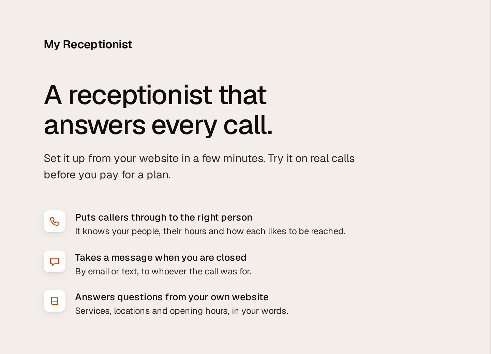

My Receptionist answers your business's phone for you. When someone rings, the receptionist greets them by your business's name, finds out what they need, and puts them through to the right person. When nobody can take the call, it takes a message and sends it on.

You set it up once, on a web page, in your own words. You can change it at any time.

<Frame>
  
</Frame>

## What it does on a call

- **Puts callers through to the right person.** It knows your people, their hours and how each likes to be reached.
- **Takes a message when you are closed, or when someone cannot take the call.** The message reaches you by email or text. See [Taking messages](/on-a-call/taking-messages) for who gets it.
- **Answers questions from your own website.** It can tell callers about your services, locations and opening hours, in your words.

For example, a caller rings a plumber's office during the day and asks for Sam. The receptionist puts the call through to Sam. If the same caller rings after hours, the receptionist says the office is closed and takes a message for Sam instead. The message is emailed to your catch-all contact, the one person you choose to receive such messages, with Sam's name in it.

You can read more in [How a call goes](/on-a-call/how-a-call-goes).

## How it fits together

- Your **workspace** is your business's account. Your receptionists, your call history and your billing live in it.
- A **receptionist** is one phone answerer, with its own name, voice, phone number, opening hours and list of people to put calls through to. Most businesses have one. You can have more than one in a workspace, for example one for each office.
- **People and teams** are the people a receptionist can put callers through to, and the groups they belong to (for example "Reception" or "Accounts").
- **People**, in the side menu, are the people who can sign in to your workspace and change things. This is a different list from **People and teams**.

## What you need to start

- **An email address.** You sign in with it, and links to finish signing up or to reset your password are sent to it.
- **Your business's details.** Its name, your opening hours, and the names, phone numbers and email addresses of the people callers ask for.
- **Your website, if you have one.** When you make a new receptionist, My Receptionist can read your website's public pages and fill in much of the set-up. You then check it.
- **A phone number for callers to ring.** You choose one on the receptionist's page. If there is none to choose, the workspace's owner can get a new one there.
- **A way to pay.** A receptionist cannot go live until the workspace has a payment method. The **Billing** page shows the plans and their prices. See [Billing](/billing/overview).

<Note>
You may not need to sign up yourself. If someone else runs My Receptionist for your business, they can add you, and you get an email with a link to choose your password. See [Sign in](/get-started/sign-in).
</Note>

## Where to go next

<CardGroup cols={2}>
  <Card title="Quickstart" href="/get-started/quickstart">
    From nothing to a receptionist answering your phone, step by step.
  </Card>
  <Card title="Sign up" href="/get-started/sign-up">
    Make your own account and workspace.
  </Card>
  <Card title="Sign in" href="/get-started/sign-in">
    Sign in with your email, or with Google or Microsoft.
  </Card>
  <Card title="Find your way around" href="/get-started/find-your-way">
    The side menu, the list of receptionists, and signing out.
  </Card>
  <Card title="Make a receptionist" href="/receptionist/create">
    Start a new receptionist, from your website or by hand.
  </Card>
  <Card title="Go live" href="/receptionist/go-live">
    Make your receptionist answer real calls.
  </Card>
</CardGroup>

## Common questions

<AccordionGroup>
  <Accordion title="What name does the receptionist give callers?">
    The name you choose for it, and your business's name as you type it. You choose both when you make the receptionist, and you can change them later. See [Make a receptionist](/receptionist/create).
  </Accordion>
  <Accordion title="Can I try it before I pay?">
    Yes, if you signed up by yourself. A receptionist that is not on a plan yet may have free test minutes, so it can take real calls before you choose a plan. See [Test minutes](/billing/test-minutes).
  </Accordion>
  <Accordion title="Can I change things after it goes live?">
    Yes. Change anything on the receptionist's page, then press **Publish changes**. Callers hear the new version from then on. See [Go live](/receptionist/go-live).
  </Accordion>
</AccordionGroup>
