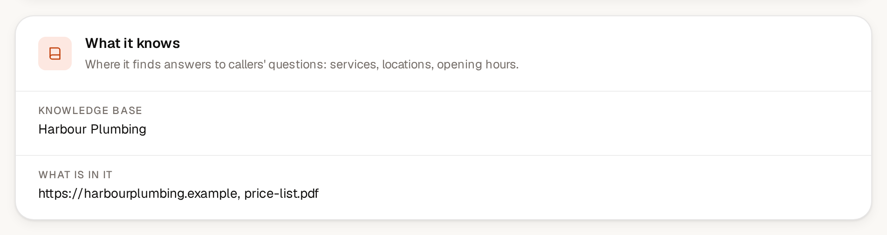

Callers often just want to know something: your hours, where you are, whether you do a certain job. The receptionist answers these questions itself, from what you have told it about your business. This page explains where its answers come from and where it stops.

## Where the answers come from

The receptionist has two sources.

- **The knowledge base** on the [What it knows](/receptionist/what-it-knows) card. This is the detail: your services, your people, your locations, your hours and common questions. The receptionist finds its answers here.
- **About the business** on the [Your business](/receptionist/your-business) card. Two or three sentences on what the business does, where and who for. The receptionist always has this in mind, so it understands what callers are talking about.

If you have no knowledge base, the receptionist has nothing to answer general questions from. It still takes messages and puts calls through.

<Frame>
  
</Frame>

## How it answers

The receptionist is asked to keep answers brief and clear and to avoid long lists. After it answers, it is asked to say:

> "Is there anything else I can help you with?"

It does not offer to put the caller through or take a message, unless the caller asks for that or asks for something it cannot give.

If the caller replies with only "thanks" or "okay", the receptionist does not take that as a goodbye. It asks "Is there anything else I can help with?" and waits. A clear "no", "that's all" or "goodbye" ends the call with the goodbye. If the reply to the second question is again only "thanks", or nothing, it ends the call.

### An example

> **Caller:** Where are you located?
>
> **Receptionist:** We're at 12 Bay Road, Wynnum, with parking at the back. Is there anything else I can help you with?
>
> **Caller:** Thanks.
>
> **Receptionist:** Is there anything else I can help with?
>
> **Caller:** No, that's it.
>
> **Receptionist:** Thank you for calling, Goodbye

The answer itself comes from your knowledge base, so it will be in the receptionist's own words.

## When it does not know

If the answer is not in the knowledge base, the receptionist is asked to say only this:

> "I don't have that information. Would you like to leave a message, or be put through to someone who can help?"

It is told not to guess.

## Prices and timeframes

The receptionist is told never to guess at prices, timeframes or how something will turn out. It gives a price or a timeframe only when your knowledge base states it, and then gives it as written. It does not give quotes.

## Advice the receptionist must never give

On the [Your business](/receptionist/your-business) card, **Advice the receptionist must never give** names the kind of advice that belongs to your team, for example "legal advice" for a law firm, or "repair or safety advice" for a trade.

The receptionist is told it is the receptionist, not one of the specialists. If a caller asks for that kind of advice, it says that needs to go to the team and offers to put them through. For example, at a plumbing business:

> **Caller:** Is it safe to keep using my gas heater if it smells a bit?
>
> **Receptionist:** That's something our team would need to advise on. Would you like me to put you through?

## A question or a need?

The receptionist treats these differently:

- **A question** about your business, such as "Do you do conveyancing?", gets an answer.
- **A need**, such as "I'm buying a house and need someone to handle it", is put through to the right person. The receptionist does not answer it, list your services or say which team handles it.

The examples in **What callers usually need help with** on the [Your business](/receptionist/your-business) card help it recognise a need. Asking about a team's area is not the same as asking to be put through to that team.

## Things it will not do

Whatever the caller asks, the receptionist is told to:

- never confirm or deny whether someone is a client or customer of your business;
- never read out a phone number from your people and teams or your knowledge base. If a caller asks for a direct number, it offers to connect them instead;
- read any phone number it does say one digit at a time;
- decline briefly, and stay calm, if a caller tries to get around these rules.

## When a caller asks the same thing again

If a caller asks something the receptionist has already answered, it gives a shorter, simpler version and asks which part is unclear. If they ask a third time, it says it may not be able to help with that and offers to take a message. If they decline, it suggests they call back and ends the call.

## Common questions

<AccordionGroup>
  <Accordion title="How do I make the receptionist answer a question it gets wrong?">
    Add the answer to your knowledge base on the [What it knows](/receptionist/what-it-knows) card. The receptionist answers from what is there.
  </Accordion>
  <Accordion title="Does the receptionist use the What they do box on a person?">
    Not yet. That box is a note for you. To describe what your business does, use **About the business**. For detail, use the knowledge base.
  </Accordion>
  <Accordion title="Will it tell callers it is an AI?">
    If a caller sincerely asks, it says it is a virtual assistant and keeps it brief.
  </Accordion>
</AccordionGroup>
