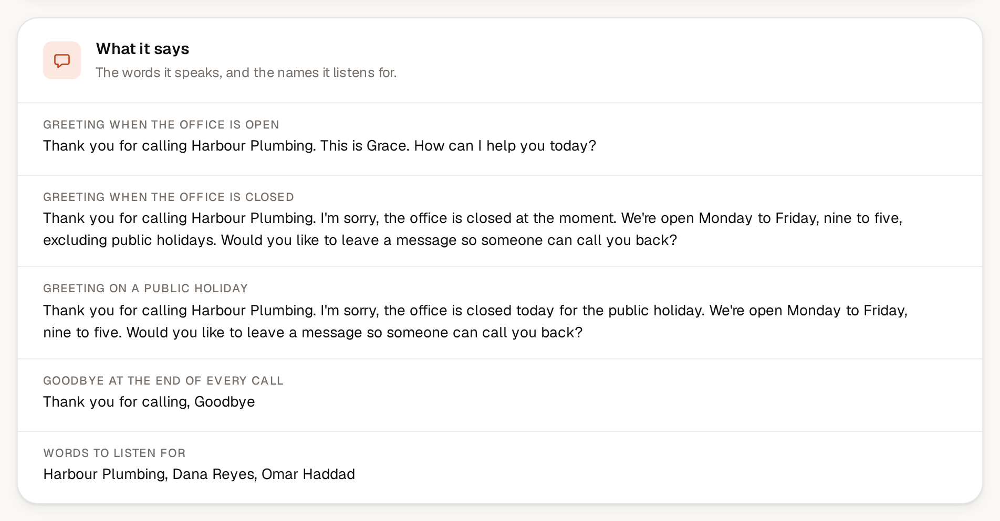

This page follows one call from start to finish: what the caller hears first, how the receptionist works out what they want, where the call goes next and how it ends.

For most of the call the receptionist replies in its own words, following the way it has been asked to behave. A few lines are fixed and always said word for word: the greetings, the goodbye and a handful of short lines. These pages show fixed lines in quotation marks. Where they describe what the receptionist is asked to say, its words may differ a little.

## Before the receptionist speaks

As soon as a call comes in, the receptionist checks the time and date where your business is. It uses the **Timezone** on the [Your business](/receptionist/your-business) card. Then it picks the greeting:

| When the call comes in | What the caller hears first |
|---|---|
| A date in your **Public holidays** list | The public holiday greeting |
| Outside your **Office hours** | The closed greeting |
| During your **Office hours** | The open greeting |

The rest of this page is about a call during office hours. For the other two, see [Closed and public holidays](/on-a-call/closed-and-public-holidays).

## The greeting

With the standard wording, the open greeting is:

> "Thank you for calling Bayside Dental. This is Ava. How can I help you today?"

"Bayside Dental" is your **Business name** and "Ava" is the **Receptionist's name**, both from the **Your business** card. You can write your own greeting on the [What it says](/receptionist/what-it-says) card.

<Frame>
  
</Frame>

The receptionist greets the caller once only. If the caller's first words are unclear, for example because they talked over the greeting, it says sorry and asks again how it can help. It does not start the greeting again.

<Note>
If you chose **Put every call straight through** for **During office hours** on the **Opening hours** card, the call goes differently: the caller hears a short greeting and is put through with nothing asked. See [Putting calls through](/on-a-call/putting-calls-through).
</Note>

## Finding out what the caller wants

After the greeting, the caller says why they are ringing. The receptionist listens for one of these:

- **A question**, such as "Are you open on Saturdays?" It answers from what it knows about your business. See [Answering questions](/on-a-call/answering-questions).
- **A person or a team**, such as "Can I speak to Dr Patel?" or just "Accounts, please". It puts the call through.
- **Something they need help with**, such as "I've chipped a tooth". It does not answer this or list your services. It puts the call through.
- **A message**, such as "Can someone call me back?" It takes a message. This wins over everything else, even if the caller also names a person.
- **Nothing more**, such as "No, that's all". It says goodbye and ends the call.

The examples you write in **What callers usually need help with** on the [Your business](/receptionist/your-business) card help the receptionist recognise a need it should put through.

## Asking who is calling

Before it puts a call through, the receptionist asks:

> "Can I get your name and what the call is about?"

It skips this question when the caller gives both while asking to be put through, for example "Hi, it's Sam Lee about my appointment. Can I speak to Dr Patel?"

It then puts the call through, whatever the answer. If the caller asks for someone the receptionist cannot match, or it cannot tell who they want, the call goes to your main contact. See [Putting calls through](/on-a-call/putting-calls-through).

## How it speaks

The receptionist is asked to:

- keep its replies short and clear, and avoid long lists;
- ask one question at a time;
- never ask the same question a third time. If it still has no answer after asking a second time in different words, it moves on, or offers to take a message or put the caller through;
- if the caller says the same thing twice, say "I'm having trouble with that. Would you like me to put you through to someone, or leave a message?";
- say it is a virtual assistant if a caller sincerely asks whether it is an AI.

## How the call ends

Every call the receptionist ends finishes with the goodbye. With the standard wording that is:

> "Thank you for calling, Goodbye"

You can change it on the [What it says](/receptionist/what-it-says) card.

The receptionist ends the call:

- when the caller says they need nothing more, or says goodbye;
- after a message has been taken;
- after the closed or public holiday greeting, if you chose **Say the greeting, then end the call** for that time.

After it answers a question, a bare "thanks" or "okay" is not taken as a goodbye. The receptionist asks if there is anything else first.

## Example calls

These show the shape of a call. Apart from the fixed lines, the receptionist's exact words will differ.

**A caller who wants a person**

> **Receptionist:** Thank you for calling Bayside Dental. This is Ava. How can I help you today?
>
> **Caller:** Hi, could I speak to Dr Patel?
>
> **Receptionist:** Can I get your name and what the call is about?
>
> **Caller:** It's Sam Lee, about my appointment next week.
>
> **Receptionist:** Thanks, I'll transfer you now.

**A caller with a question**

> **Receptionist:** Thank you for calling Harbour Plumbing. This is Ava. How can I help you today?
>
> **Caller:** Do you do hot water systems?
>
> **Receptionist:** Yes, we install and repair hot water systems for homes and small businesses. Is there anything else I can help you with?
>
> **Caller:** No, that's all.
>
> **Receptionist:** Thank you for calling, Goodbye

## Common questions

<AccordionGroup>
  <Accordion title="Does the receptionist tell the caller it is putting them through?">
    Yes. Just before it connects the caller, it says "Thanks, I'll transfer you now." With **Put every call straight through**, the greeting itself says so instead.
  </Accordion>
  <Accordion title="Will it ask for the caller's name twice?">
    It can. It asks for the name and reason each time it gets ready to put the call through, unless the caller gives both in the same breath as asking. If the first person cannot take the call and the caller names someone else, it tries them without asking again.
  </Accordion>
  <Accordion title="Can I change what the receptionist says?">
    You can change the greetings and the goodbye on the [What it says](/receptionist/what-it-says) card. The other lines on these pages are standard and cannot be changed.
  </Accordion>
</AccordionGroup>

<CardGroup cols={2}>
  <Card title="Putting calls through" href="/on-a-call/putting-calls-through">
    Who the call goes to and what happens if they do not answer.
  </Card>
  <Card title="Taking messages" href="/on-a-call/taking-messages">
    What the receptionist asks for and where the message goes.
  </Card>
</CardGroup>
