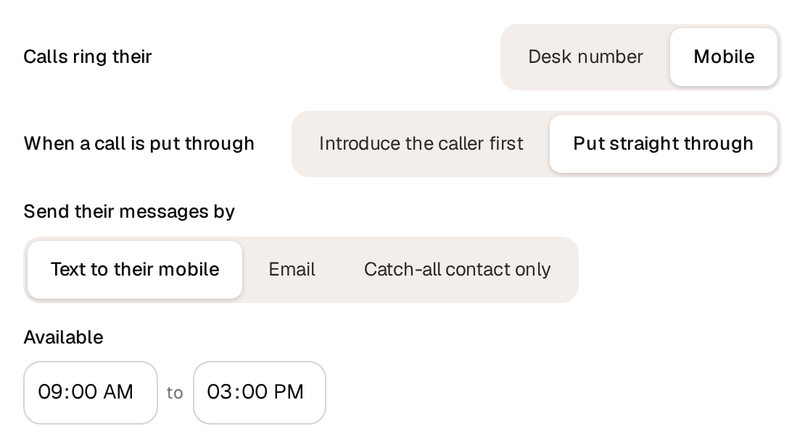

When a caller asks for someone, or says what they need help with, the receptionist puts the call through to one of the people or teams on the [People and teams](/receptionist/people-and-teams) card. This page explains who it chooses, which phone rings, and what the caller hears when the call cannot be put through.

## Only during office hours

The receptionist puts calls through only while the office is open. On a public holiday, or outside your **Office hours**, a caller who asks to be put through hears:

> "I'm sorry, I can't put you through while the office is closed. Would you like to leave a message?"

See [Closed and public holidays](/on-a-call/closed-and-public-holidays).

## Who the call goes to

The receptionist matches what the caller says against the names of your people and teams.

- **The caller names a person.** The call goes to that person, even if what they need would normally go to a team.
- **The caller names a team, or says what they need.** The call goes to the team. A team's **What it covers** box tells the receptionist which calls belong to it, for example "buying and selling property".
- **The caller uses part of a name**, such as a first name or a surname. The receptionist matches it to the closest name on your list. This also helps when a name is slightly misheard.
- **The caller asks for someone who is not listed, or the receptionist cannot tell who they want.** The call goes to your catch-all contact.

<Note>
The **What they do** box on a person is a note for you. The receptionist does not use it yet. To send a kind of call to someone, add a team for it with a **What it covers** description and put them in it.
</Note>

## The catch-all contact

One entry under **People** on the **People and teams** card is marked **Catch-all**. You choose it by ticking **Catch-all contact** in that person's edit panel. It is often a shared line such as Reception rather than one person. It is the safety net:

- Calls that are not clearly for anyone are put through to it.
- Some messages go to it by email, and messages emailed to other people are copied to it. Messages sent by text are not copied to it. See [Taking messages](/on-a-call/taking-messages).

The catch-all contact must have an email address.

## Before the call is put through

The receptionist asks "Can I get your name and what the call is about?", unless the caller gave both while asking to be put through. Then it says:

> "Thanks, I'll transfer you now."

## Which phone rings

Each person has a **Calls ring their** setting with two choices:

| Choice | What rings |
|---|---|
| **Desk number** | Their landline or main number |
| **Mobile** | Their mobile |

## Introduced first or straight through

Each person also has a **When a call is put through** setting:

| Choice | What happens |
|---|---|
| **Introduce the caller first** | The receptionist speaks to the person first and says who is calling, in one short sentence such as "Sam Lee is calling about an appointment." Then the caller is connected. |
| **Put straight through** | The caller is connected with no introduction. |

If the caller gave no name, the introduction says "A caller" instead of a name.

Teams do not have these settings. They are set on each person.

<Frame>
  
</Frame>

## When the person is not available

Each person has an **Available** time, for example 09:00 to 17:00, in your business's timezone. Calls are only put through to them between those times. If both times are cleared, they can take calls at any time.

If a caller asks for someone outside their available time, the receptionist says:

> "Dr Patel isn't available at the moment. Would you like to leave a message, or try someone else?"

## When the call is not answered

If the call is put through but not taken, the caller comes back to the receptionist and hears:

> "I wasn't able to put you through. Would you like to leave a message, or try someone else?"

Then the receptionist follows the caller:

- **They name another person or team.** It tries them.
- **They say "someone else" or "anyone".** It asks who they would like to speak with, then tries that person.
- **They want to leave a message, or there is nobody else.** It takes a message.
- **They are finished.** It says goodbye and ends the call.

After two tries that do not work, the caller hears "I wasn't able to put you through. Would you like to leave a message so someone can call you back?" From there the receptionist takes a message, answers a question or says goodbye. It does not offer to try anyone else.

## Putting every call straight through

On the [Opening hours](/receptionist/opening-hours) card, **During office hours** has two choices:

- **The receptionist answers the call**: everything above.
- **Put every call straight through**: every call during office hours goes to one person you choose, with nothing asked. You choose the person under **Put every call through to**.

With **Put every call straight through**, the caller hears a short greeting and is then connected. Nothing else is said, not even "Thanks, I'll transfer you now." The standard greeting is:

> "Thank you for calling Harbour Plumbing. I'll put you through now."

The caller cannot talk over this greeting. The person you choose must be set to **Put straight through** under **When a call is put through**, or the page shows it as something to fix.

If the person does not take the call, or it is outside their **Available** time, the caller hears "I wasn't able to put you through. Would you like to leave a message so someone can call you back?" The receptionist can then take a message or answer a question. It does not try anyone else.

Calls outside office hours and on public holidays are handled the same way with either choice.

<Tip>
If the person you put every call through to has their own **Available** time, make sure it covers your office hours. Outside it, calls are not put through to them. The page warns you when it does not.
</Tip>

## Direct numbers

If a caller asks for someone's direct number, extension or mobile, the receptionist says it cannot read out direct numbers but can connect them now. It never reads out a phone number from your people and teams or from what it knows, however much the caller insists.

## Common questions

<AccordionGroup>
  <Accordion title="Can a caller ask for a person by first name only?">
    Yes. The receptionist takes a first name, a surname or a topic as who the caller wants, and matches it to the right person or team.
  </Accordion>
  <Accordion title="Can the caller ask the receptionist a question instead?">
    Yes. Asking about a team's area is not the same as asking to be put through. If the caller only asks a question, the receptionist answers it. See [Answering questions](/on-a-call/answering-questions).
  </Accordion>
  <Accordion title="Does the receptionist put calls through on a public holiday?">
    No. On the dates in your **Public holidays** list the office counts as closed, and calls are not put through.
  </Accordion>
</AccordionGroup>
