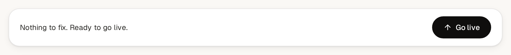
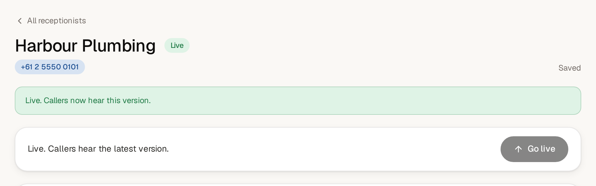
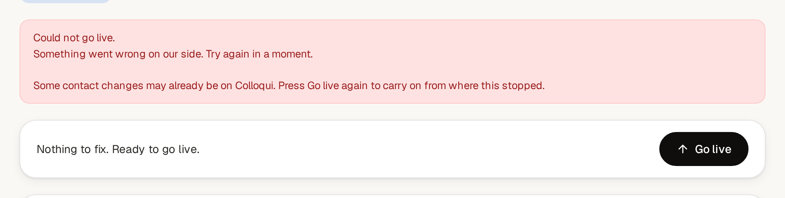

Your changes save by themselves, but callers do not hear them yet. A caller only gets the new greeting, the new person or the new hours once you press **Go live** (the first time) or **Publish changes** (after that). This page explains the Go live bar, what happens when you press it, and what can stop it.

## The Go live bar

The bar sits at the top of the receptionist's page, above the cards. On the left it says where things stand. On the right is the button, with "Saves your changes and makes them live for callers."

<Frame>
  
</Frame>

| The bar says | What it means | The button |
|---|---|---|
| Nothing to fix. Ready to go live. | Not live yet, and nothing stops it. | **Go live** |
| 2 things to fix before the receptionist can go live. | Problems are listed under it. See [Things to fix](/receptionist/things-to-fix). | **Go live** (it will refuse until they are fixed) |
| You have changes that are not live yet. | It is live, and you have saved changes callers do not hear yet. | **Publish changes** |
| Live. Callers hear the latest version. | Callers hear everything you have saved. | Greyed out: there is nothing to send. |

Warnings can add a sentence such as "1 thing worth a look." These do not stop it. If a change has not saved yet, the bar adds "You have unsaved changes, so this may be out of date."

If it is live with changes waiting and there are also things to fix, the line "You have changes that are not live yet." shows beside the button instead.

## Go live, step by step

<Steps>
  <Step title="Fix anything listed">
    If the bar lists things to fix, press each one to go to where it is fixed.
  </Step>
  <Step title="Press Go live or Publish changes">
    A question asks, for example: "Make "Bayside Dental Receptionist" live now? Callers will hear this version straight away." Press **OK**.
  </Step>
  <Step title="Wait for it to finish">
    A message box above the bar shows how it is going. The button is greyed out meanwhile.
  </Step>
  <Step title="Check the result">
    When it worked, the box says "Live. Callers now hear this version." and the tag by the name says **Live**.
  </Step>
</Steps>

<Frame>
  
</Frame>

## What happens after you press it

One press does it all. Your latest changes are saved and checked. Then the people and teams are brought up to date, the receptionist is updated with this version, its phone number is connected, and finally the version is made live for callers.

While it works, the message box shows what it is doing, for example:

- "Getting this version ready…"
- "Waiting to start…"
- "Checking…"
- "Updating contacts…" (contacts means people and teams)
- "Updating the receptionist…"
- "Finishing…"
- "Going live…"
- "Removing contacts taken off the receptionist…" (only when you removed people) or "Finishing…"

### How long it takes

The page does not give a time. You can leave the page while it works. It carries on, and if you open the receptionist again while it is still going, the page shows how it is going. If it has not finished after 20 minutes, the page stops waiting and says "This did not finish. Press Go live again to carry on from where it stopped." Press **Go live** again to carry on.

### People you removed

People you removed from **People and teams** are only deleted for good at this point, as the receptionist goes live. The message then adds "Contacts deleted from Colloqui:" and their names.

## The tags by the name

The tag beside the receptionist's name, at the top of the page, shows its state.

| Tag | What it means |
|---|---|
| **Not live** | It has never gone live. Callers cannot reach it yet. |
| **Not live yet** | A version was prepared but not made live, for example because going live stopped part way. Press **Go live**. |
| **Live** | Callers reach it. |
| **Checking…** | The page is still finding out. |
| **Not known** | The page could not find out. |
| **Deleted** | The receptionist was deleted outside this page, so it cannot answer calls. Pressing **Go live** makes it again. |
| **2 things to fix** | An amber tag counting the problems that stop it going live. |

The line under the name shows the phone numbers it answers, or "No phone number yet." or "Not live yet.". For tags on the list of receptionists, see [Find your way around](/get-started/find-your-way).

## What can stop it

Each of these is shown in the message box above the bar. Nothing reaches callers when going live is refused.

| The message says | What to do |
|---|---|
| Saved, but not live. 2 things to fix first: (then a list) | Fix each one. See [Things to fix](/receptionist/things-to-fix). |
| Not live. Colloqui needs a payment method on this workspace before a receptionist can go live. Nothing was changed on Colloqui. Add one in Billing, then press Go live again. | Add a payment method on the **Billing** page. If you cannot open Billing, the message says to ask the owner of the workspace instead. See [Billing](/billing/overview). |
| Not live. Colloqui has not finished reading the knowledge base "…", so the receptionist cannot use it yet. Nothing was changed on Colloqui. Wait until every item says Ready (remove any that failed), then press Go live again. | Wait, or remove items that failed. See [What it knows](/receptionist/what-it-knows). |
| Not live. The knowledge base chosen for this receptionist no longer exists on Colloqui. Nothing was changed on Colloqui. Choose another, or None, then press Go live again. | Choose another knowledge base, or **None**. |
| Not live. The changes made in the Colloqui dashboard were left as they are, and nothing was changed on Colloqui. | You chose not to replace changes made elsewhere. See "Changed somewhere else" below. |
| Could not go live. Your changes are saved, but your account is not allowed to make them live. Ask someone who can go live to press Go live. | Ask someone with the right to go live. See [People and roles](/workspace/people-and-roles). |
| Could not go live. Number … is already used by another receptionist, so it was not connected to this one. Choose a spare number under Phone number, then press Go live again. | Choose another number on **Voice and number**. Some people are told instead to ask whoever set up the receptionist. |
| Could not go live. this receptionist is being changed by someone else right now; try again in a moment | Someone else is going live with it. Wait a moment, then try again. |
| This receptionist was updated by someone else. | Someone else's go-live finished. The page now shows their version. Check it, then press the button again if needed. |
| Not live. My Receptionist is missing the key for sending email, which the receptionist needs. Nothing was changed on Colloqui. Tell support: this is set up on our side, not on this page. (It may name a different key.) | Contact support. |
| Could not go live. The receptionist was not put together properly. … | Fix anything you recognise in the list. Otherwise contact support with the list. |
| This did not finish. Press Go live again to carry on from where it stopped. | Press **Go live** again. |

Some messages add "Some contact changes may already be on Colloqui. Press Go live again to carry on from where this stopped." Press **Go live** again.

<Frame>
  
</Frame>

For free minutes, plans and why calls might stop, see [Free minutes](/billing/free-minutes) and [Plans and minutes](/billing/plans-and-minutes).

### Stopped part way

Sometimes the receptionist is updated but not made live, because something did not fully work. The message then ends "It is not live yet. Press Go live to make it live for callers." Before that it says what went wrong, for example that the phone number was not connected ("Choose the number again under Phone number, then press Go live again.") or that some settings or contact details were not kept as sent. Do what it says, then press **Go live** again.

### Changed somewhere else

If someone changed this receptionist outside My Receptionist since it last went live, the line under the name says so, with the number of changes. When you press **Go live**, a second question asks whether to replace those changes with what is on your page. Press **OK** to replace them. Press **Cancel** to leave them, and nothing is sent.

## If you do not see the button

Some roles may change a receptionist but not make it live. In its place the bar says "Your changes are saved. Someone who is allowed to go live needs to press Go live." See [People and roles](/workspace/people-and-roles).

## Common questions

<AccordionGroup>
  <Accordion title="Do my changes reach callers as I type?">
    No. They are saved, but callers only hear them after **Go live** or **Publish changes**.
  </Accordion>
  <Accordion title="Why is the button greyed out?">
    Either it is already working, or the receptionist is live and nothing has changed since: the bar says "Live. Callers hear the latest version."
  </Accordion>
  <Accordion title="Can I close the page while it goes live?">
    Yes. It carries on. Open the receptionist again to see how it went.
  </Accordion>
</AccordionGroup>
