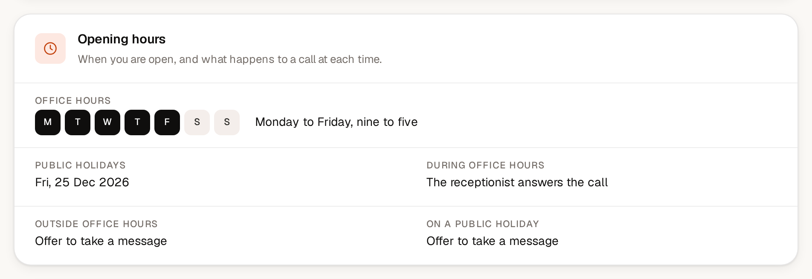
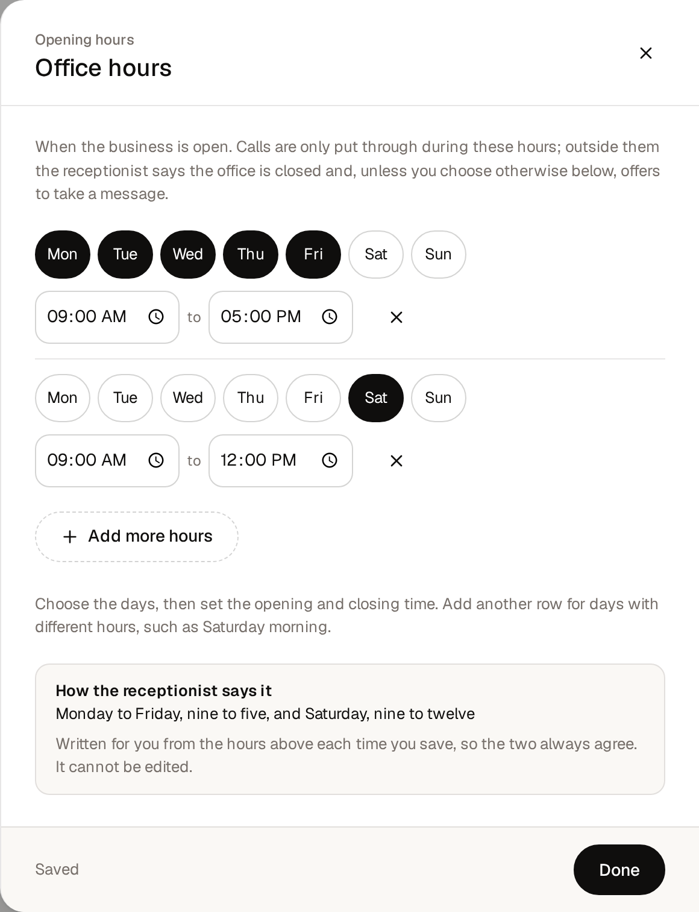
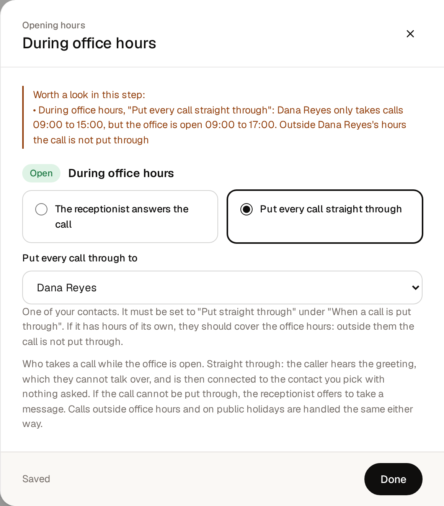
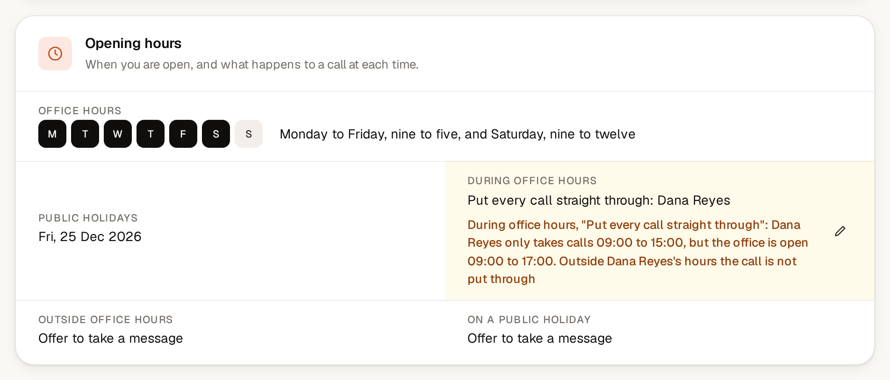

The **Opening hours** card decides what a caller gets depending on when they ring. During office hours the receptionist can put calls through. Outside them it says the office is closed. On a public holiday it says the office is closed for the holiday. At both of those times you choose whether it then offers to take a message or ends the call.

The card's line reads "When you are open, and what happens to a call at each time." It has five rows: **Office hours**, **Public holidays**, **During office hours**, **Outside office hours** and **On a public holiday**. Press a row to open it in the panel on the right. Changes save by themselves.

<Frame>
  
</Frame>

## Office hours

The row shows a strip of seven squares, M T W T F S S, with your open days filled in, and the hours as the receptionist says them, such as "Monday to Friday, nine to five". With no hours yet it says "No hours saved yet".

The panel explains: "Calls are only put through during these hours; outside them the receptionist says the office is closed and, unless you choose otherwise below, offers to take a message."

<Steps>
  <Step title="Open the Office hours row">
    The panel shows one line for each set of days. With none yet it says "No hours yet."
  </Step>
  <Step title="Choose the days and times">
    Tick the days (Mon to Sun), then set the opening and closing time.
  </Step>
  <Step title="Add days with different hours">
    Press **Add more hours** for another line, such as Saturday morning. A new line starts as Saturday, 09:00 to 12:00. To remove a line, press the ✕ at its end.
  </Step>
</Steps>

<Frame>
  
</Frame>

Under the lines, **How the receptionist says it** shows the hours in words. It is "Written for you from the hours above each time you save, so the two always agree. It cannot be edited." The standard closed and public holiday greetings use these words to tell callers when you are open, for example "We're open Monday to Friday, nine to five."

For example, a plumber open weekdays 07:00 to 16:00 and Saturday 08:00 to 12:00 adds two lines.

You need at least one line. Each line needs at least one day, and the closing time must be later than the opening time. See [Things to fix](/receptionist/things-to-fix).

## Public holidays

The panel explains: "Days the business is closed. On these days callers hear the public holiday greeting."

<Steps>
  <Step title="Open the Public holidays row">
    The panel lists the dates you have added, or "No dates yet." The row on the card shows the same dates.
  </Step>
  <Step title="Add a date">
    Choose a date in the date box and press **Add a date** (or press Enter).
  </Step>
  <Step title="Remove a date">
    Press the × beside the date.
  </Step>
</Steps>

If you press **Add a date** with no date chosen, it says "Choose a date first." If the date is already there, it says "That date is already in the list."

Add each holiday's date separately, for every year you need.

## What happens when someone calls

The last three rows each have their own choices. The row shows the choice you made. In the panel, each one has a small tag: **Open**, **Closed** or **Holiday**.

<Frame>
  
</Frame>

### During office hours

| Choice | What happens on a call |
|---|---|
| **The receptionist answers the call** | The receptionist greets the caller, finds out what they need, and puts them through or takes a message. A new receptionist starts with this choice. |
| **Put every call straight through** | The caller hears the greeting, which they cannot talk over, and is then connected to one person you choose, with nothing asked. The standard greeting becomes "Thank you for calling" and your business name, then "I'll put you through now." If the call cannot be put through, the caller hears "I wasn't able to put you through. Would you like to leave a message so someone can call you back?" |

With **Put every call straight through**, a list appears: **Put every call through to**. It starts at "Choose a contact…": pick one of your people. The row then shows the choice and the name, such as "Put every call straight through: Dana Reyes". Until you pick someone it ends in "no contact chosen yet" (a contact here means a person).

That person must be set to **Put straight through** under **When a call is put through** in their own panel. Until they are, the receptionist cannot go live. Their own **Available** hours should cover the office hours: outside their hours the call is not put through. See [People and teams](/receptionist/people-and-teams).

The panel adds: "Calls outside office hours and on public holidays are handled the same either way."

### Outside office hours

| Choice | What happens on a call |
|---|---|
| **Offer to take a message** | The caller hears the closed greeting, which in the standard wording asks whether they would like to leave a message. A new receptionist starts with this choice. |
| **Say the greeting, then end the call** | The caller hears the closed greeting, which they cannot talk over, then the goodbye, and the call ends. |

### On a public holiday

The same two choices, after the public holiday greeting instead of the closed greeting. The public holiday greeting is only used on the dates in **Public holidays**.

<Warning>
If the call ends after the greeting, "the caller cannot leave a message or ask anything, so the greeting should not ask a question." When you choose **Say the greeting, then end the call**, the standard greeting changes to one without a question. If you wrote your own greeting on the **What it says** card, it is left as you wrote it. If it still asks a question, the page tells you, for example: "The closed greeting asks a question, but with "Say the greeting, then end the call" chosen the receptionist does not listen for an answer." See [What it says](/receptionist/what-it-says).
</Warning>

More detail on each of these is in [Closed and public holidays](/on-a-call/closed-and-public-holidays) and [Putting calls through](/on-a-call/putting-calls-through).

## When the straight-through person's hours are shorter

If you choose **Put every call straight through** and the person's **Available** hours do not cover all your office hours, the **During office hours** row shows a warning like this:

"During office hours, "Put every call straight through": Dana Reyes only takes calls 09:00 to 16:00, but the office is open 09:00 to 17:00. Outside Dana Reyes's hours the call is not put through"

<Frame>
  
</Frame>

This is a warning, not something you must fix. You can still go live. But in this example, a caller ringing at 4:30 pm is not put through: they hear "I wasn't able to put you through" and are offered a message. To fix it, do one of these:

- Open the person under **People and teams** and widen their **Available** times, or clear both times so they take calls at any time.
- Choose a different person, or choose **The receptionist answers the call**.

## Common questions

<AccordionGroup>
  <Accordion title="We close for lunch. How do I set that?">
    Add two lines for the same days, for example Monday to Friday 08:30 to 12:30 and Monday to Friday 13:30 to 17:00.
  </Accordion>
  <Accordion title="Which timezone are the hours in?">
    The receptionist's timezone, set on the **Your business** card. See [Your business](/receptionist/your-business).
  </Accordion>
  <Accordion title="Can I change the words for the hours?">
    Not in this panel. **How the receptionist says it** is written for you from the hours, so it always matches them. You can write a greeting of your own on the **What it says** card instead.
  </Accordion>
  <Accordion title="Do changes reach callers straight away?">
    No. They are saved, but callers only hear them after you press **Go live** or **Publish changes**. See [Go live](/receptionist/go-live).
  </Accordion>
</AccordionGroup>
