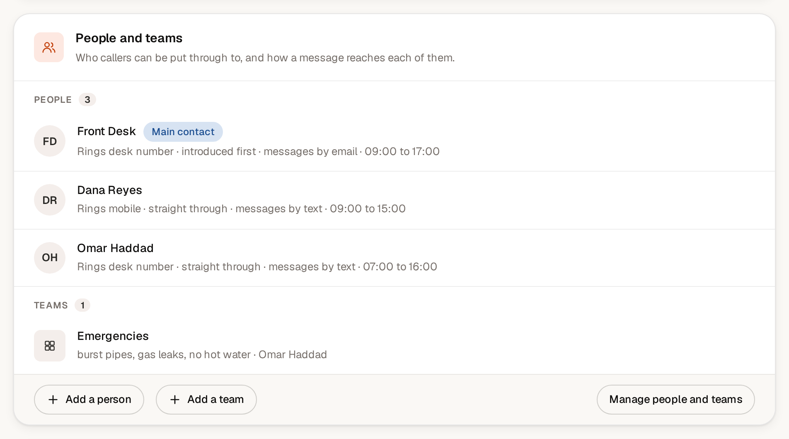
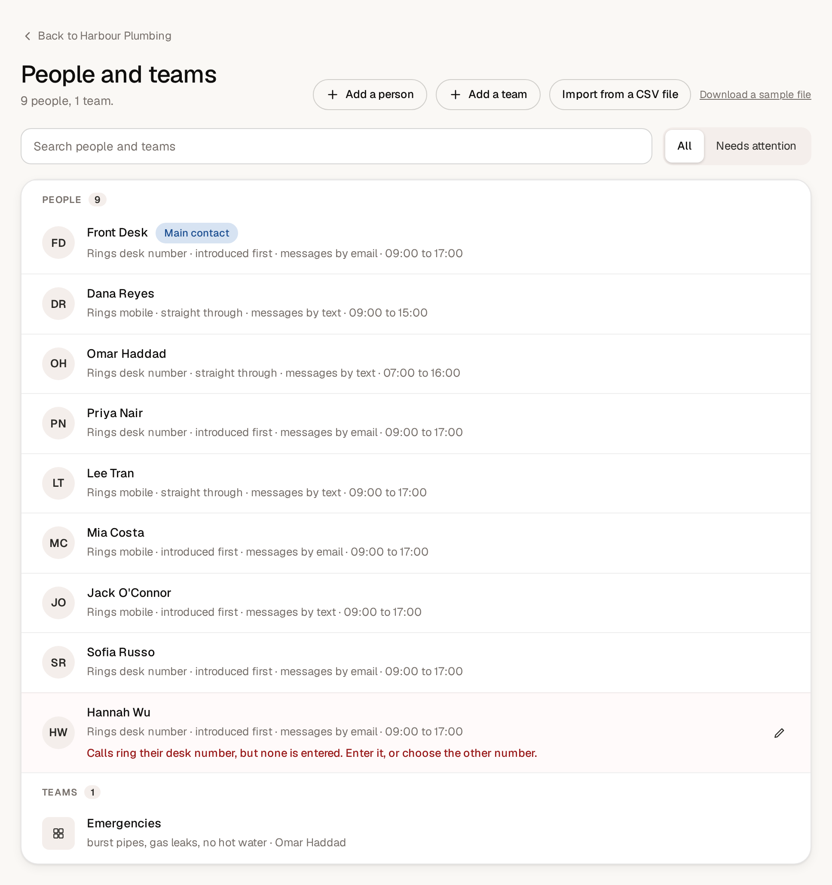
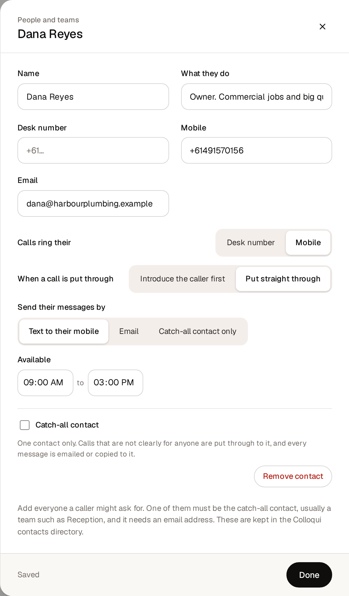
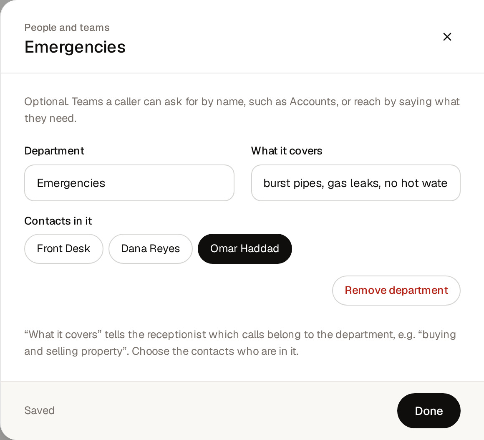

When a caller asks for someone, the receptionist looks in **People and teams**. Everyone a caller might ask for goes here: each person's numbers, when they take calls, whether the caller is introduced first, and how a message left for them reaches them. Teams let a caller ask for a group, such as Accounts, or be sent there by saying what they need.

<Note>
**People and teams** is about who callers can reach. It is not the same as **People** in **Settings**, which is about who can sign in to your workspace. For that, see [People and roles](/workspace/people-and-roles).
</Note>

<Frame>
  
</Frame>

## The People and teams card

The card is on the receptionist's page. Its line reads "Who callers can be put through to, and how a message reaches each of them." It has two lists:

- **People**, with a count. Each row shows the person's initials, their name and a short line such as "Rings desk number · introduced first · messages by email · 09:00 to 17:00". The main contact has a blue **Main contact** tag.
- **Teams**, with a count. Each row shows what the team covers and who is in it, or "No one in it yet".

The card shows the first five people and the first five teams, plus anyone with something to fix. Under the lists are **Add a person**, **Add a team** and a button to the full list. That button reads **Manage people and teams**, or **See all, 4 more** (with the right number) when some rows are not shown.

If a person has a problem, it is written under their row: in red for something to fix, in amber for something only worth a look. An amber tag beside the card's title, such as "1 to fix", counts the problems that stop the receptionist going live. When there are no people yet the card says "No contacts yet." (contacts here means people), and with no teams, "No teams yet." See [Things to fix](/receptionist/things-to-fix).

If your provider has locked this card, it says "Your provider has locked this." and you cannot change it. See [Access and locks](/workspace/access-and-locks).

## The People and teams page

A long list is easier to manage on its own page. Press **Manage people and teams** (or **See all**) on the card.

<Frame>
  
</Frame>

The page shows the same rows, opened in the same panel, and changes save the same way. At the top it says how many there are, such as "9 people, 0 teams." It has:

- **Add a person** and **Add a team**.
- **Import from a CSV file** and **Download a sample file**, for adding many people at once from a spreadsheet saved as a CSV file. These are only on this page. See [Import people from a file](/receptionist/import-people).
- A search box, **Search people and teams**. It matches names and the words in each row's line. When nothing matches it says "Nobody matches that."
- **All** and **Needs attention**. **Needs attention** shows only the people with something to fix or worth a look. Teams are not shown in this view.

Press **Back to** and your receptionist's name to return to the receptionist's page.

## Add a person

<Steps>
  <Step title="Press Add a person">
    Use the button on the card or on the People and teams page. A panel opens on the right with a new, empty person.
  </Step>
  <Step title="Fill in the boxes">
    Start with **Name**. The boxes are described below.
  </Step>
  <Step title="Press Done">
    Changes save by themselves. The bottom of the panel shows "Saving…" and then "Saved". **Done** closes the panel.
  </Step>
</Steps>

<Frame>
  
</Frame>

A new person starts with the caller introduced first, calls ringing their desk number, and messages going to the main contact only. Their **Available** hours start from your earliest opening time to your latest closing time. If you have no office hours yet, they start empty, which means any time.

| What you see | What it does |
|---|---|
| **Name** | Who callers ask for. "A person, or a team such as Reception. Callers ask for them by this name." Two people cannot share a name. |
| **What they do** | "A note on their role, for you. The receptionist does not use it yet." To send a kind of call to someone, put them in a team instead. |
| **Desk number** | Their landline or main number, starting with the country code, for example +61352468897. |
| **Mobile** | Their mobile, starting with the country code. Needed if their messages go by text. |
| **Email** | Needed if their messages go by email. |
| **Calls ring their** | **Desk number** or **Mobile**: which number rings when a caller is put through to them. That number must be filled in. |
| **When a call is put through** | **Introduce the caller first**: the receptionist speaks to them first and says who is calling. **Put straight through**: the caller is connected with no introduction. |
| **Send their messages by** | **Text to their mobile**, **Email**, or **Main contact only**. With the last choice, a message for them goes to the main contact and not to them. |
| **Available** | The times calls can be put through to them, for example 08:00 to 16:00, in the receptionist's timezone. Clear both times for any time. Fill in both or neither. |
| **Main contact** | Tick this for the one person who takes calls that are not clearly for anyone. See below. |

What these mean on a call is covered in [Putting calls through](/on-a-call/putting-calls-through) and [Taking messages](/on-a-call/taking-messages).

### Example

A dental practice adds Dr Mia Chen. Calls ring her **Mobile**, she is introduced first, her messages go by **Text to their mobile**, and she is available 08:00 to 16:00. A caller who asks for her at 3 pm is put through, and she hears who is calling before she is connected. At 5 pm she is not put through, and the caller is offered a message or someone else instead.

## The main contact

Every receptionist needs exactly one main contact. The panel explains it: "One contact only. Calls that are not clearly for anyone are put through to it, and every message is emailed or copied to it."

- The panel suggests it is "usually a team such as Reception". You add it under **People**, as one entry with the front desk's number. Teams cannot be the main contact.
- It must have an email address. Messages for nobody in particular, and messages for anyone set to **Main contact only**, are emailed to it. A copy of every message emailed to a person goes to it too.
- Messages sent to a person by text are not copied to it, although the panel says "every message".
- Ticking **Main contact** on one person unticks it on everyone else.

Without exactly one main contact, or with no email on it, the receptionist cannot go live.

## Add a team

A team is a group a caller can ask for by name, such as Accounts, or reach by saying what they need. Teams are optional.

<Steps>
  <Step title="Press Add a team">
    The panel opens with a new team.
  </Step>
  <Step title="Name it and say what it covers">
    Fill in **Department**, the team's name, for example Conveyancing. Then **What it covers**, for example "buying and selling property". This tells the receptionist which calls belong to the team.
  </Step>
  <Step title="Choose who is in it">
    Under **Contacts in it** (the people in the team), tick each person in the team. Every team needs at least one. If there are no people yet, it says "Add a contact first."
  </Step>
</Steps>

<Frame>
  
</Frame>

For example, a law firm adds a team called Conveyancing that covers "buying and selling property", with two solicitors in it. A caller who says "I'm selling my house" can be sent to that team.

## Remove a person or a team

Open the person or team and press **Remove contact** (for a person) or **Remove department** (for a team). There is no "are you sure" question, and the change saves straight away.

A person you remove is also taken out of every team they were in. Callers can still be put through to them until you go live or publish your changes. See [Go live](/receptionist/go-live).

## Changes and going live

Changes to people and teams save by themselves, but callers only get them after you press **Go live** or **Publish changes**. People you removed are deleted for good at that point, and the message after going live names them.

## Common questions

<AccordionGroup>
  <Accordion title="Why does the receptionist not use What they do?">
    The page says so: "The receptionist does not use it yet." It is a note for you. To have certain calls go to someone, make a team, say what it covers, and put them in it.
  </Accordion>
  <Accordion title="Can a person be in more than one team?">
    Yes. Tick them under **Contacts in it** in each team.
  </Accordion>
  <Accordion title="Someone only works mornings. What do I set?">
    Set **Available** to their hours, for example 08:00 to 12:00. Outside those times calls are not put through to them.
  </Accordion>
  <Accordion title="Why can I not edit this card?">
    Your provider has locked it. See [Access and locks](/workspace/access-and-locks).
  </Accordion>
</AccordionGroup>

<CardGroup cols={2}>
  <Card title="Import people from a file" href="/receptionist/import-people">Add many people at once.</Card>
  <Card title="Things to fix" href="/receptionist/things-to-fix">Every problem this card can show, and the fix.</Card>
</CardGroup>
