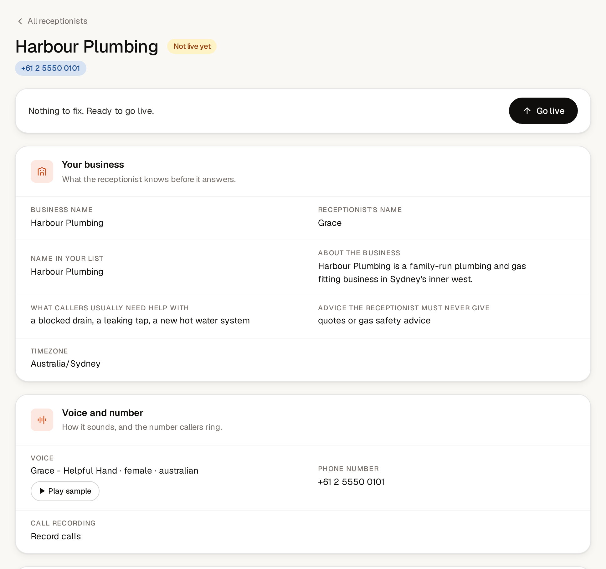
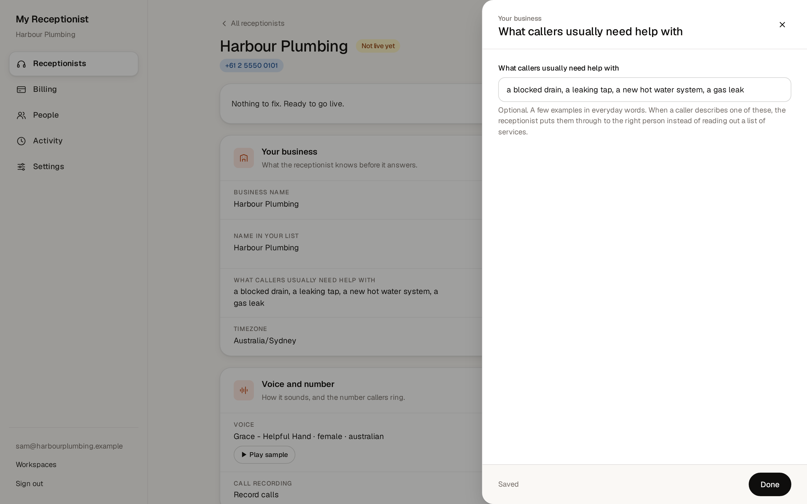
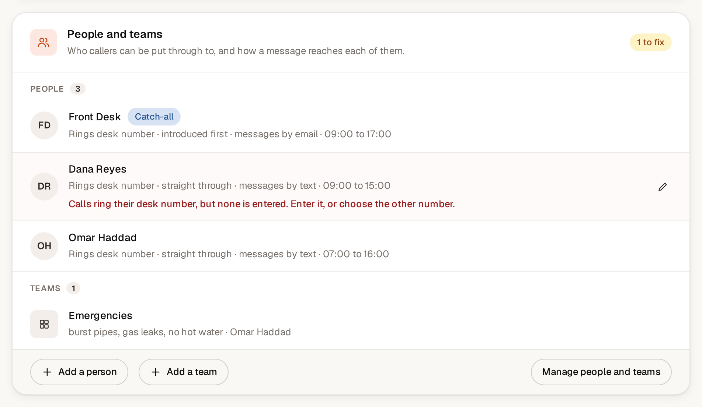
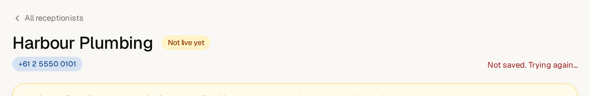
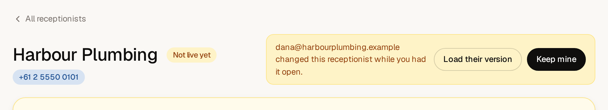

Everything about how a receptionist handles your calls is on one page: what it says when it answers, who it puts callers through to, when you are open, and what it knows. This page explains how to find your way around it and make changes. You open a receptionist's page by choosing it on the **Receptionists** page.

<Frame>
  
</Frame>

## The top of the page

At the top you see:

- **All receptionists**, to go back to your list.
- The receptionist's name, with a tag saying whether it is live, such as **Live**, **Not live** or **Not live yet**. If something stops it going live, a second tag says how many things, for example **1 thing to fix**.
- Under the name, the phone number callers ring once it is live, or a short line such as "Not live yet."
- On the right, a **Calls** button (when call history is set up for your workspace) and the line that shows whether your changes are saved. See [Saving happens by itself](#saving-happens-by-itself).

## The Go live bar

Under the top of the page is the Go live bar. It says one thing:

- what is still to fix, for example "1 thing to fix before the receptionist can go live.", with each problem listed under it; or
- "Nothing to fix. Ready to go live."; or
- on a receptionist that is already live, "You have changes that are not live yet." or "Live. Callers hear the latest version."

Each listed problem starts with the name of its card. Press it to open the row that needs fixing, or to go to its card.

The button on the right reads **Go live**, or **Publish changes** on a receptionist that is already live. If you are not allowed to make changes live, you see "Your changes are saved. Someone who is allowed to go live needs to press Go live." instead. See [Go live](/receptionist/go-live) and [Things to fix](/receptionist/things-to-fix).

## The six cards

Below the Go live bar are six cards, always in this order. Each has a title and one short line saying what it is for.

| Card | What it covers |
|---|---|
| **Your business** | The business name, the receptionist's name, what the business does, and the timezone. See [Your business](/receptionist/your-business). |
| **Voice and number** | How it sounds, the number callers ring, and whether calls are recorded. See [Voice and number](/receptionist/voice-and-number). |
| **People and teams** | Who callers can be put through to, and how a message reaches each of them. See [People and teams](/receptionist/people-and-teams). |
| **Opening hours** | When you are open, public holidays, and what happens to a call during office hours, outside them and on a public holiday. See [Opening hours](/receptionist/opening-hours). |
| **What it says** | Its greetings and goodbye, and the names it listens for. See [What it says](/receptionist/what-it-says). |
| **What it knows** | Where it finds answers to callers' questions. See [What it knows](/receptionist/what-it-knows). |

The **People and teams** card shows the first five people and the first five teams, plus anyone with something to fix. Press **Manage people and teams** to see everyone on a page of their own. When some are not shown, the button reads, for example, **See all, 3 more**.

## Rows

Each card is made of rows. A row has a small label in capitals, such as **BUSINESS NAME**, and under it what is set now. On the **People and teams** card, each row is a person's or team's name instead. When nothing is set yet, the row says so, for example **Not added yet** or **Not chosen yet**.

## Open a row to change it

<Steps>
  <Step title="Click anywhere on the row">
    The whole row opens it. On a computer, a pencil appears at the right of the row when you point at it. On a touch screen the pencil always shows. A row with nothing in it yet shows a plus instead, all the time.
  </Step>
  <Step title="Make your change in the panel">
    A panel opens on the right of the screen (it fills the screen on a phone). At its top is the card's name and the row's name. Help for each box is shown under it.
  </Step>
  <Step title="Close the panel">
    Press **Done**, the cross at the top, the Esc key, or click beside the panel. Your change is saved straight away, and you are back on the row you opened.
  </Step>
</Steps>

<Frame>
  
</Frame>

Some things inside a row work without opening it, such as **▶ Play sample** on the **Voice** row and the **From your website** tag.

## Tags

A tag marks only what is different from the usual:

- **Your wording**: on the **What it says** card, a line you wrote yourself instead of the standard wording. See [What it says](/receptionist/what-it-says).
- **Catch-all**: on the **People and teams** card, the person who takes calls and messages for anyone not listed.
- **From your website**: a row that was filled in from your website and still needs checking. See [Create a receptionist](/receptionist/create#check-what-was-filled-in).

## How problems are shown

When something needs your attention, it is said on the row it belongs to, under the value:

- **Red**, with the row shaded red: something to fix. The receptionist cannot go live until it is fixed.
- **Amber**, with the row shaded amber: worth a look. It does not stop going live, but the receptionist may not behave as you expect.

Each card counts its problems that must be fixed in an amber tag beside its title, for example **1 to fix**. A problem that belongs to no single row is shown in a red or amber box at the top of the card, headed "To fix in this step:" or "Worth a look in this step:".

<Frame>
  
</Frame>

When you open a row with a problem, the panel shows that problem too, so you can fix it there.

## Saving happens by itself

There is no save button. Your changes save by themselves:

- about two seconds after you stop typing;
- straight away when you make a choice, add or remove something, or close the panel.

A line at the top right of the page, and at the bottom of the panel, tells you where things are:

| What the line says | What it means |
|---|---|
| **Saving…** | Your change is being saved now. |
| **Saved** | Everything is saved. Later it shows how long ago, for example **Saved 2 minutes ago**. |
| **Not saved. Trying again…** | The save did not go through, for example because your internet dropped. It keeps trying while the page is open. |
| **Not saved.** | The save was refused. A message says why, ending "They are still on the page. They are saved again when you next change something." |

<Frame>
  
</Frame>

While anything is not yet saved, your browser warns you if you try to leave the page.

Saving is not the same as going live. Saved changes are not heard by callers until you press **Go live** or **Publish changes**.

## When two people change the same receptionist

If someone else saves changes to this receptionist while you have it open, your next save is held back, so neither of you overwrites the other without knowing. The saved line is replaced by a message, such as "sam@harbourplumbing.com.au changed this receptionist while you had it open.", and two buttons:

- **Load their version**: shows their changes. Any of your changes that were not saved are dropped.
- **Keep mine**: saves your version over theirs.

Nothing more is saved until you choose one. Someone with the **Customer** role sees "Someone else changed this receptionist while you had it open." instead of the other person's email address.

<Frame>
  
</Frame>

## Locked cards

People with the **Owner** or **Staff** role can lock some cards of a receptionist, so that people with the **Customer** role cannot change them. On a locked card you see "Your provider has locked this." beside the title, and its rows cannot be opened. You can still read what is set. See [Access and locks](/workspace/access-and-locks).

People with the **Customer** role also see the phone number without being able to change it, whether or not the card is locked.

## Common questions

<AccordionGroup>
  <Accordion title="Do callers hear my changes as soon as they are saved?">
    No. Saved changes are kept for you, but callers hear them only after you press **Go live** (or **Publish changes**).
  </Accordion>
  <Accordion title="I closed the browser while it said Saving…. Is my change lost?">
    The page tries to send the change as you leave. If you are unsure, open the receptionist again and check the row.
  </Accordion>
  <Accordion title="Why is the pencil missing on some rows?">
    On a computer, the pencil appears only when you point at the row. If it never appears and clicking does nothing, the card is locked, or your role does not let you change that row.
  </Accordion>
</AccordionGroup>
