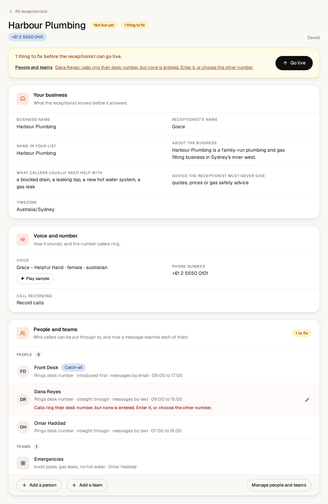
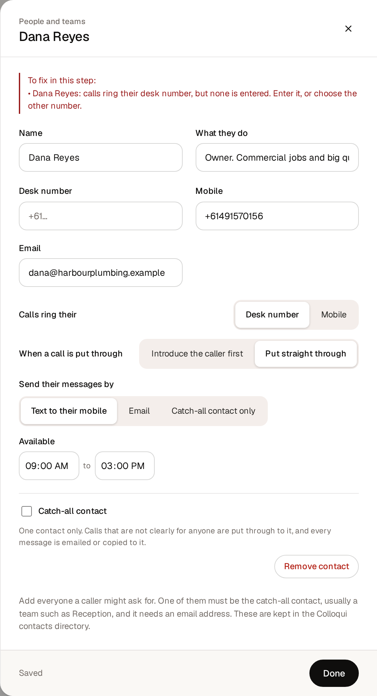

Each time your changes save, My Receptionist checks the receptionist for problems that would spoil a call, such as a person whose phone number is missing. This page lists every message it can show, card by card, with the fix.

## Must fix, or worth a look

There are two kinds of message.

- **Must fix** (red). The receptionist cannot go live until it is fixed. Each one is counted.
- **Worth a look** (amber). A warning about something that may not work the way you expect. You can still go live.

## Where they appear

<Frame>
  
</Frame>

- **On the row.** The message is written under the row it is about, in red or amber. On a person's row their name is left off the front, as it is already there.
- **On the card.** A tag beside the card's title counts the must-fix problems on it, such as "1 to fix". A problem that is not about one row is shown in a box at the top of the card, headed "To fix in this step:" or "Worth a look in this step:".
- **By the receptionist's name.** A tag such as "2 things to fix".
- **In the Go live bar.** It says, for example, "2 things to fix before the receptionist can go live." Under that is a list of each problem, with the card's name in front. Press one to open the place where it is fixed.
- **In the panel.** When you open a row with a problem, the message is shown at the top of the panel, in a box headed "To fix in this step:" or "Worth a look in this step:".

<Frame>
  
</Frame>

When you fix it, the page checks again as soon as the change saves, and the message goes. If you have changed something that has not saved yet, a box may add "Found in what was last saved. Save to check again." There is no Save button: changes save by themselves within a few seconds.

The **People and teams** page also has a **Needs attention** button that shows only the people with a message.

In the messages below, a name such as Dana Reyes or Accounts stands for the person or team concerned. Many messages say "contact" where the page says person, and "department" where the page says team.

## Your business

These show on the **Business name** row, whichever box is empty.

| The message says | How to fix it |
|---|---|
| Enter the business name. | Fill in **Business name**. |
| Enter the receptionist's name. | Fill in **Receptionist's name**. |
| Enter a name for your list. | Fill in **Name in your list**. |
| Choose a timezone. | Choose a **Timezone**. |
| Say what advice the receptionist must never give. | Fill in **Advice the receptionist must never give**. |
| About the business is 812 characters long. Keep it to 600 or fewer, and put the detail in the knowledge base. | Shorten **About the business**. Put longer detail on the **What it knows** card. |

See [Your business](/receptionist/your-business).

## Voice and number

| The message says | How to fix it |
|---|---|
| The voice chosen is no longer available. Choose a voice from the list. | Open **Voice** and choose another. |
| The voice chosen cannot be used. Choose a voice from the list. | The same. |

See [Voice and number](/receptionist/voice-and-number).

## People and teams

All of these must be fixed. A message that starts with a person's name shows on that person's row. The others show in the box at the top of the card.

| The message says | How to fix it |
|---|---|
| Add at least one contact. | Add a person. |
| Choose one contact as the catch-all contact. Calls and messages for anyone not listed go there. | Open the right person and tick **Catch-all contact**. Only one can be ticked. |
| Reception: the catch-all contact needs an email, because every message is emailed or copied to them. | Add an **Email** to the catch-all person. |
| A contact has no name. Enter a name for every contact. | Find the person with no name and fill in **Name**, or remove them. |
| Two contacts are called Sam. Give each a different name. | Rename one. |
| …: the name is too long. Keep it to 255 characters or fewer. (It starts with the first 40 letters of the name, then "…".) | Shorten the name. |
| Dana Reyes: the desk number needs to start with + and the country code, with no spaces, for example +61352468897. | Correct **Desk number**. The same message can name the mobile number. |
| Dana Reyes: the email does not look like an email address. | Correct **Email**. |
| Dana Reyes: calls ring their desk number, but none is entered. Enter it, or choose the other number. | Fill in that number, or change **Calls ring their**. |
| Dana Reyes: their messages go by text, but no mobile is entered. Enter one, or send their messages another way. | Fill in **Mobile**, or change **Send their messages by**. |
| Dana Reyes: their messages go by email, but no email is entered. Enter one, or send their messages another way. | Fill in **Email**, or change **Send their messages by**. |
| Dana Reyes: enter both the time they are available from and the time they are available to, or leave both blank. | Fill in both **Available** times, or clear both. |
| Dana Reyes: enter the times they are available in hours and minutes, for example 09:00. | Correct the **Available** times. |
| Dana Reyes: choose whether calls ring their desk number or their mobile. | Choose under **Calls ring their**. |
| Dana Reyes: choose what happens when a call is put through. | Choose under **When a call is put through**. |
| Dana Reyes: choose how their messages are sent. | Choose under **Send their messages by**. |
| Dana Reyes: this contact was not saved properly. Remove it and add it again. | Remove the person and add them again. |
| Two contacts were mixed up when saving. Remove the newer one and add it again. | As it says. |

A problem with a person who has no name starts "A contact with no name:" instead of a name.

Problems with teams are shown in the box at the top of the card, not on the team's row:

| The message says | How to fix it |
|---|---|
| A department has no name. Enter a name for every department. | Open the team and fill in **Department**. |
| Two departments are called Accounts. Give each a different name. | Rename one. |
| Department Accounts: choose at least one contact for it. | Open the team and tick someone under **Contacts in it**. |
| Department Accounts: one of its contacts no longer exists. Open the department and choose its contacts again. | Open the team and tick its people again. |
| Department Accounts: this department was not saved properly. Remove it and add it again. | As it says. |
| Two departments were mixed up when saving. Remove the newer one and add it again. | As it says. |

See [People and teams](/receptionist/people-and-teams).

## Opening hours

| The message says | Kind | How to fix it |
|---|---|---|
| Add at least one set of opening hours. | Must fix | Open **Office hours** and add a line. |
| Choose at least one day for each set of opening hours. | Must fix | Tick a day on each line, or remove the empty line. |
| Enter each opening and closing time in hours and minutes, for example 09:00. | Must fix | Correct the times. |
| A closing time must be later than its opening time. | Must fix | Correct the times. |
| The public holiday "…" is not a date. Remove it and add it again. | Must fix | Under **Public holidays**, remove that date with its × and add it again. |
| During office hours, "Put every call straight through": choose the contact. | Must fix | Open **During office hours** and choose a person under **Put every call through to**. |
| During office hours, "Put every call straight through": open Dana Reyes under Contacts and set "When a call is put through" to "Put straight through". | Must fix | "Contacts" here means **People and teams**. Open that person there and, under **When a call is put through**, choose **Put straight through**. |
| During office hours, "Put every call straight through": the name Dana is also part of Dana Reyes, so the receptionist cannot tell them apart. Rename one of them. | Must fix | Rename one so neither name is part of the other. |
| During office hours, "Put every call straight through": Dana Reyes only takes calls 09:00 to 16:00, but the office is open 09:00 to 17:00. Outside Dana Reyes's hours the call is not put through | Worth a look | Widen the person's **Available** times, or choose someone else. |
| Putting every call straight through is not available for this receptionist. Choose another option for office hours. | Must fix | Choose **The receptionist answers the call**. |
| Choose what happens during office hours. | Must fix | Open **During office hours** and choose. |
| A choice saved for this receptionist is no longer offered. Open this card, choose again, then save. | Must fix | Open the row with the message and choose again. This can also show on **Call recording**. |

See [Opening hours](/receptionist/opening-hours).

## What it says

| The message says | Kind | How to fix it |
|---|---|---|
| Add at least one name or word callers are likely to say, such as a staff name. It helps the receptionist hear it correctly. | Must fix | Add words under **Words to listen for**. |
| The greeting is too long. Keep it to 300 characters or fewer. | Must fix | Shorten it. The same applies to each greeting and the goodbye. |
| The greeting must be on one line, with no line breaks. | Must fix | Remove the line breaks. |
| The greeting has brackets that cannot be used. Only `{firm}`, `{persona}` and `{hours}` can be used in curly brackets. | Must fix | Remove the doubled brackets (two curly or two square brackets together). |
| The greeting has `{name}`, which cannot be filled in. Only `{firm}`, `{persona}` and `{hours}` can be used in curly brackets. | Must fix | Use one of the three short codes the message names, or remove it. |
| The closed greeting asks a question, but with "Say the greeting, then end the call" chosen the receptionist does not listen for an answer. | Worth a look | Reword the greeting without a question, or change the choice on **Opening hours**. The holiday greeting can show the same. |
| The closed greeting does not say when the office is open. Add `{hours}` where the opening hours should be said. | Worth a look | Type the short code `{hours}` into your greeting where the hours should be said. The holiday greeting can show the same. |
| The greeting does not end with a question, so callers may wait for the receptionist to carry on. | Worth a look | End the open-office greeting with a question, such as "How can I help you today?" |

See [What it says](/receptionist/what-it-says).

## What it knows

These are not on the card. They are listed in the Go live bar, with **What it knows** in front, before you press **Go live**.

- The knowledge base is still being read. The message tells you to wait until every item says **Ready** before going live.
- An item could not be read. The message tells you to remove it, or choose **None**, before going live.

If the receptionist does not already use that knowledge base, **Go live** is refused until every item says **Ready**.

See [What it knows](/receptionist/what-it-knows).

## Not on any card

| The message says | How to fix it |
|---|---|
| Check the 3 things we filled in from your website | Shown when the receptionist was started from your website. Press it to go to the "We filled in" line at the top. Check each row named there, then press **These look right**. Changing a row also counts as checking it. See [Create a receptionist](/receptionist/create). |
| This receptionist was not set up properly. Tell support. | Contact support. |
| This receptionist could not be checked. Try saving again, and if you see this again tell support. | Change something so it saves again. If it comes back, contact support. |
| The address that messages are sent from is not set. Tell support. | Contact support. |
| Something saved for this receptionist is no longer used. Tell support. | Contact support. |

## Problems found while going live

A last check runs when you press **Go live**. If it finds something, the Go live bar shows a line starting **Final check:**, and the message box says "Could not go live. The receptionist was not put together properly. If nothing below is something you can change, tell support and include this list:". Fix anything in the list you recognise. Otherwise contact support with the list.

Other reasons **Go live** can be refused, such as a missing payment method, are on the [Go live](/receptionist/go-live) page.

## Common questions

<AccordionGroup>
  <Accordion title="Do I have to fix the amber ones?">
    No. They do not stop the receptionist going live. Read them, though: each one describes something a caller may run into.
  </Accordion>
  <Accordion title="I fixed it but the message is still there.">
    The check runs after the change saves. Wait for "Saved" at the top of the page or the bottom of the panel.
  </Accordion>
</AccordionGroup>
