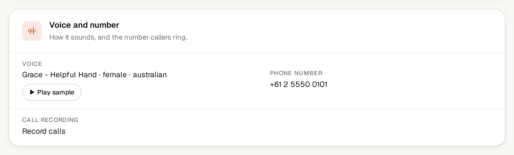
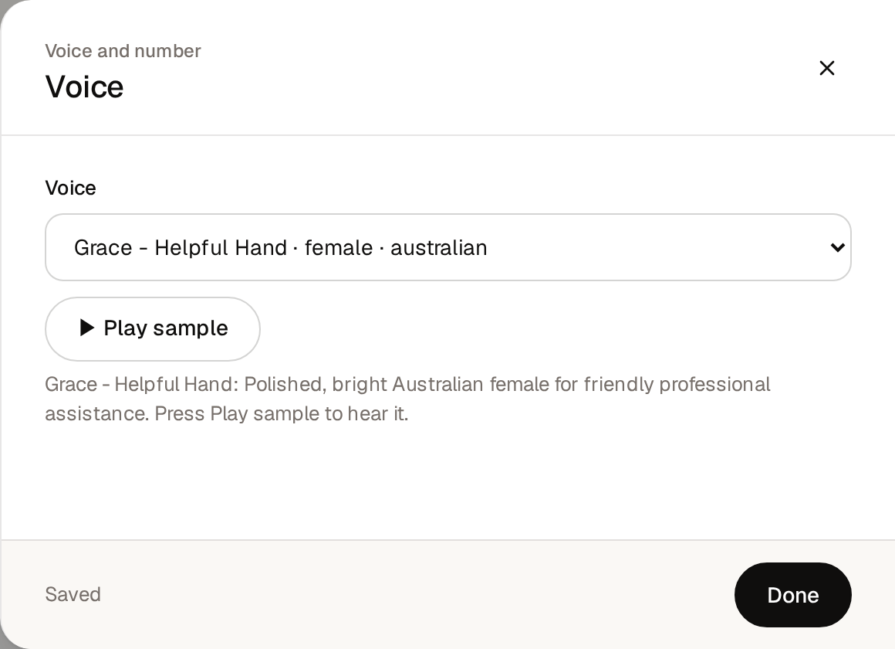
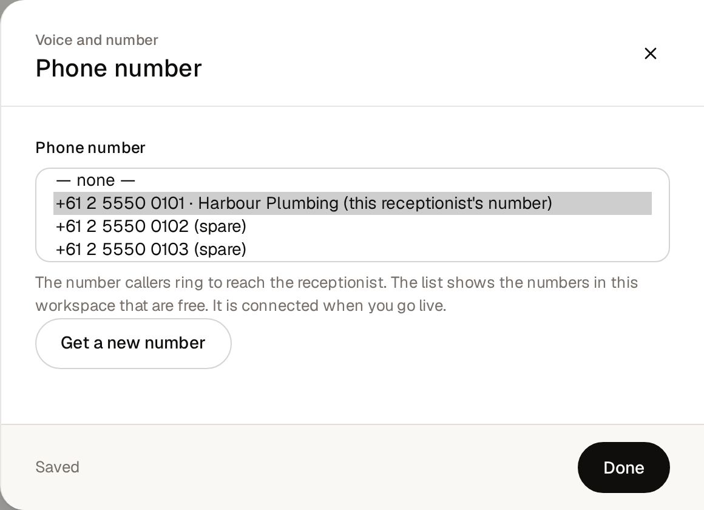
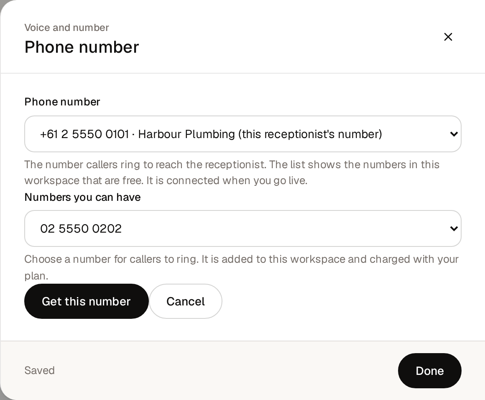
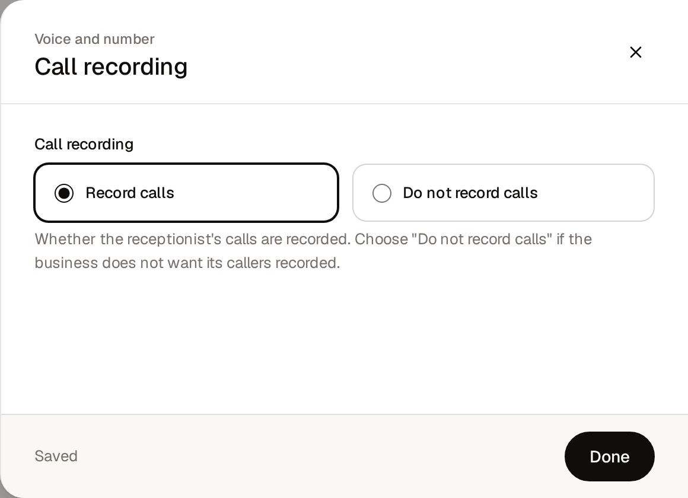

The **Voice and number** card decides what callers hear and where they ring: the voice that answers, the phone number your receptionist answers on, and whether its calls are recorded. Its line reads "How it sounds, and the number callers ring."

<Frame>
  
</Frame>

## The rows

| What you see | What it does | Choices |
|---|---|---|
| **Voice** | How the receptionist sounds on the phone. | A voice from the list, or the standard voice. |
| **Phone number** | The number callers ring to reach the receptionist. | A free number in your workspace. |
| **Call recording** | Whether the receptionist's calls are recorded. | **Record calls** or **Do not record calls**. |

Callers hear changes to this card only after you press **Go live** (or **Publish changes**). See [Go live](/receptionist/go-live).

## Choose a voice

The **Voice** row shows the voice in use, such as "Jess · female · australian": its name, then details such as whether it sounds female or male and its accent. If you have not picked one, it shows **Dashboard voice**: the receptionist uses the standard voice.

To hear the voice without opening anything, press **▶ Play sample** on the row.

<Steps>
  <Step title="Open the Voice row">
    Click the **Voice** row. A panel opens with a list of voices, in groups.
  </Step>
  <Step title="Pick a voice">
    Choose one from the list. The line under the list describes it.
  </Step>
  <Step title="Press ▶ Play sample">
    You hear a short sample of the voice. If the line says "(no sample)", that voice has no sample to play and the button cannot be pressed.
  </Step>
  <Step title="Press Done">
    The voice is saved straight away.
  </Step>
</Steps>

<Frame>
  
</Frame>

To go back to the standard voice, choose the first entry in the list.

### If your voice is no longer offered

Voices are sometimes taken out of the list. If yours was, the row shows **Voice not in the list**, the list shows "Your saved voice (no longer in the list)", and the row may say "The voice chosen is no longer available. Choose a voice from the list." Pick another voice to fix it.

## Choose the phone number

The **Phone number** row shows the number callers ring, or **Not chosen yet**.

<Steps>
  <Step title="Open the Phone number row">
    Click the **Phone number** row.
  </Step>
  <Step title="Choose a number">
    The list shows the numbers in your workspace that are free, plus the one this receptionist already has. Each is followed by a note:
    - "(this receptionist's number)": the number it answers on now.
    - "(spare)": a number not in use by any receptionist.
    - "(was on a deleted receptionist)": a number left over from a receptionist that was deleted.

    Choose **— none —** to take the number off.
  </Step>
  <Step title="Press Done">
    The choice is saved. The number is connected to the receptionist when you go live, not before.
  </Step>
</Steps>

<Frame caption="The list is shown opened out in the panel; on your screen it drops down when you click it.">
  
</Frame>

If the number saved for this receptionist is no longer in your workspace, the row shows **Number no longer available** and the list shows "Your saved number (no longer available, choose again)". Choose another number.

### If you cannot change the number

People with the **Customer** role see the number but cannot open the row. Your provider chooses the number. With none set, the row says "No phone number yet. Your provider sets this up." See [Access and locks](/workspace/access-and-locks).

## Get a new number

The workspace's owner can get a new number here, for example when the workspace has no free number. Only the **Owner** sees **Get a new number**, because a number is charged to the workspace with your plan. See [Billing](/billing/overview).

<Steps>
  <Step title="Open the Phone number row">
    Click the **Phone number** row.
  </Step>
  <Step title="Press Get a new number">
    It shows **Looking for numbers…** for a moment, then a list headed **Numbers you can have**.
  </Step>
  <Step title="Choose a number">
    Pick the one you want from the list, for example "02 5550 0201".
  </Step>
  <Step title="Press Get this number">
    The button reads **Getting the number…** while it works. Then a message says, for example, "02 5550 0201 is yours and is chosen for this receptionist. It is connected when you go live."
  </Step>
</Steps>

<Frame>
  
</Frame>

Press **Cancel** to close the list without getting a number.

The new number belongs to your workspace. It is chosen for this receptionist straight away, and it is connected at **Go live**, like any other number.

### When a new number cannot be had

| Message | What to do |
|---|---|
| "There are no numbers to choose from just now. Contact us and we will add one for you." | No numbers are on offer at the moment. Contact support to have one added. |
| "Colloqui needs a payment method on this workspace before a number can be bought. Nothing was bought. Add one in Billing, then try again." | Add a payment method on the **Billing** page, then try again. See [Billing](/billing/overview). |
| "That number has just been taken. Nothing was bought. Choose another." | Someone else got that number first. Choose another one. |
| "The payment for the number did not go through, so it was not bought. Check the payment method in Billing, then try again." | Check your payment method on the **Billing** page. |
| "Only the owner of this workspace can get a new phone number. Ask them to." | Ask the workspace's owner. |
| "Could not look for numbers:" followed by a reason | The list could not be fetched. Try again later. |

When any of these appear, no number was bought.

## Call recording

This decides whether the receptionist's calls are recorded. New receptionists start on **Record calls**.

<Steps>
  <Step title="Open the Call recording row">
    Click the **Call recording** row.
  </Step>
  <Step title="Choose Record calls or Do not record calls">
    Choose **Do not record calls** if your business does not want its callers recorded. The choice saves straight away.
  </Step>
</Steps>

<Frame>
  
</Frame>

For example, a medical or legal practice may decide not to record calls. For what recording means during a call, see [Call recording](/on-a-call/call-recording).

## When the card is locked

If "Your provider has locked this." shows beside the card's title, its rows cannot be opened. You can still press **▶ Play sample** to hear the voice. See [Access and locks](/workspace/access-and-locks).

## Common questions

<AccordionGroup>
  <Accordion title="Does choosing a number make it ring my receptionist straight away?">
    No. The number is connected to the receptionist when you press **Go live**. Until then, calls to it are not answered by this receptionist.
  </Accordion>
  <Accordion title="Can I give a number back, or move it to another workspace?">
    Not from this page. Contact support.
  </Accordion>
  <Accordion title="Can I see what a number costs before I get it?">
    The page does not show the price of a number. It is charged with your plan; the **Billing** page shows your charges.
  </Accordion>
  <Accordion title="Can I choose a number by area code?">
    Not at the moment. The list shows the numbers on offer, up to 30.
  </Accordion>
</AccordionGroup>
