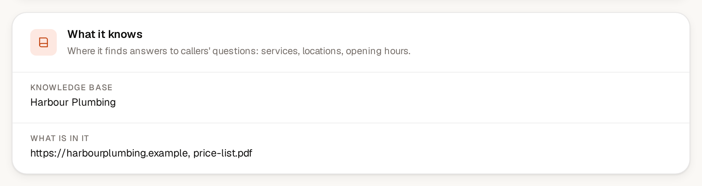
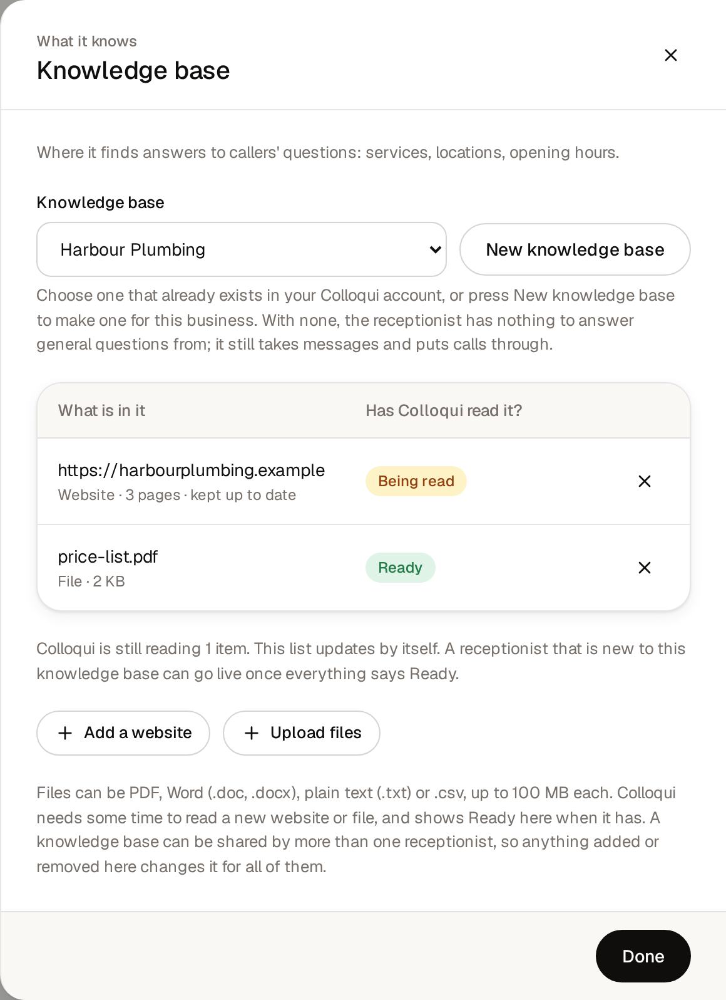
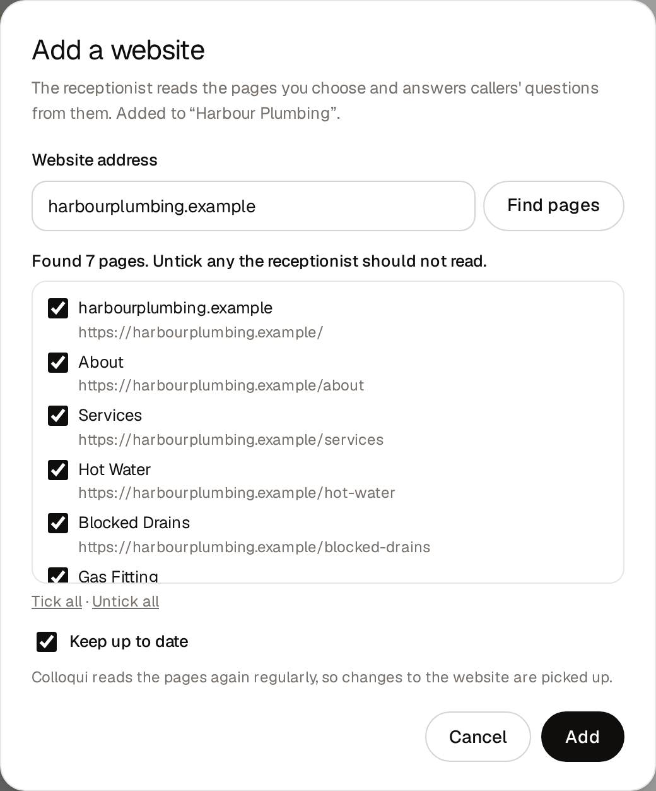

When a caller asks a general question, such as "Do you do Saturday appointments?" or "Where do I park?", the receptionist looks for the answer in its **knowledge base**. A knowledge base is a collection of your website pages and files. The **What it knows** card is where you choose one, and add to it or take things out.

The card's line reads "Where it finds answers to callers' questions: services, locations, opening hours."

A knowledge base is optional. Without one, the receptionist cannot answer general questions, but it still takes messages and puts calls through. How the receptionist uses it on a call is in [Answering questions](/on-a-call/answering-questions).

<Frame>
  
</Frame>

## The card

The card has up to two rows:

- **Knowledge base**: the name of the one this receptionist uses, or "None chosen". While items are still being read it says so, such as "Bayside Dental · reading 2 items". An empty one shows, for example, "Bayside Dental · nothing in it yet". If something could not be read it says, for example, "1 item could not be read".
- **What is in it**: the websites and files in it. An item still being read has "(still being read)" after it, and one that failed has "(could not be read)". An empty one says "Nothing in it yet. Add a website or upload files."

Press either row to open the panel.

## Choose or make a knowledge base

<Steps>
  <Step title="Open the Knowledge base row">
    On the **What it knows** card, press the **Knowledge base** row.
  </Step>
  <Step title="Choose one, or make a new one">
    Pick one from the **Knowledge base** list, or choose **None**. To start a fresh one, press **New knowledge base**.
  </Step>
  <Step title="For a new one, check the name">
    In the box that opens, **Name** starts as your business name. Change it if you like. If the business has a website, type it in **Website address (optional)** and press **Find pages** (see below). Files can be added once it is made.
  </Step>
  <Step title="Press Create">
    It says "Knowledge base “Bayside Dental” created. It is now this receptionist's knowledge base." If **Name** is empty, the box says "Give the knowledge base a name."
  </Step>
</Steps>

Only people with the **Owner** or **Staff** role can choose or make a knowledge base. See [If you cannot choose a knowledge base](#if-you-cannot-choose-a-knowledge-base).

<Warning>
A knowledge base can be shared by more than one receptionist. Anything you add or remove changes it for all of them.
</Warning>

<Frame>
  
</Frame>

## Add website pages

<Steps>
  <Step title="Press Add a website">
    Open the **What is in it** row. The button is under the table in the panel.
  </Step>
  <Step title="Type the address and press Find pages">
    For example www.example.com.au. The button reads **Looking…** while it searches.
  </Step>
  <Step title="Untick pages you do not want">
    The page lists what it found, up to the first 100 pages. Use **Tick all** or **Untick all** to save time.
  </Step>
  <Step title="Choose Keep up to date">
    It is ticked to start with. The pages are then read again regularly, so changes to your website are picked up. Untick it to read them once only.
  </Step>
  <Step title="Press Add">
    It says the website was added and is being read now.
  </Step>
</Steps>

What the box can say after **Find pages**:

- "Found 24 pages. Untick any the receptionist should not read." With more than 100, it adds "(the site has more; these are the first 100)".
- "This website does not list its pages, so only the page you entered can be read. To add other pages, add each address the same way."
- "That address could not be opened. Check the spelling. If it is right, you can still add it."

If you press **Add** with no address typed, the box says "Type the website address, then press Find pages." If you typed an address but did not press **Find pages**, pressing **Add** looks for the pages first so you can choose them. With every page unticked, it says "Tick at least one page."

<Frame>
  
</Frame>

## Upload files

Press **Upload files** and choose one or more files.

Files can be PDF, Word (.doc, .docx), plain text (.txt) or .csv, up to 100 MB each.

While they upload, the panel shows, for example, "Uploading 1 of 3: price-list.pdf…". Then a message says which were uploaded. A file that is not allowed is not sent, with a reason such as "price-list.xlsx: not a PDF, Word, text or .csv file" or "brochure.pdf: larger than 100 MB".

For example, a vet uploads a PDF of their vaccination prices and a Word document with their after-hours emergency details.

## The "being read" state

New websites and files are not ready straight away. They have to be read first. The table's second column shows where each one is up to:

| What you see | What it means |
|---|---|
| **Waiting to be read** | Added, not started yet. |
| **Being read** | Reading is under way. |
| **Ready** | Done. The receptionist can answer from it. |
| **Failed** | It could not be read. Remove it with the ✕ and add it again. |

The note under the table says how many items are still being read, and that "This list updates by itself." When all are done it says "Everything has been read."

<Note>
While anything is still being read, or could not be read, the Go live bar lists it as something to fix. A receptionist that does not already use this knowledge base cannot go live until everything says **Ready**. See [Things to fix](/receptionist/things-to-fix).
</Note>

## Remove something

Press the ✕ at the end of its row in the table. You are asked to confirm, with a warning that "Every receptionist that uses this knowledge base loses it. This cannot be undone."

## If you cannot choose a knowledge base

With the **Customer** role you cannot choose or make a knowledge base. If none is set up, the card says "No knowledge base yet. Your provider sets this up." Once one is set up for you, you can add websites and files to it and remove them, unless the card is locked. See [Access and locks](/workspace/access-and-locks).

## Common questions

<AccordionGroup>
  <Accordion title="How long does reading take?">
    The page does not give a time. The list updates by itself, so you can leave the panel open or come back later.
  </Accordion>
  <Accordion title="I changed my website. Do I need to add it again?">
    Not if **Keep up to date** was ticked when you added it: the row says "kept up to date". If it says "read once", remove it and add it again.
  </Accordion>
  <Accordion title="Do I need a knowledge base?">
    No. Without one the receptionist still takes messages and puts calls through. It just cannot answer general questions.
  </Accordion>
</AccordionGroup>
