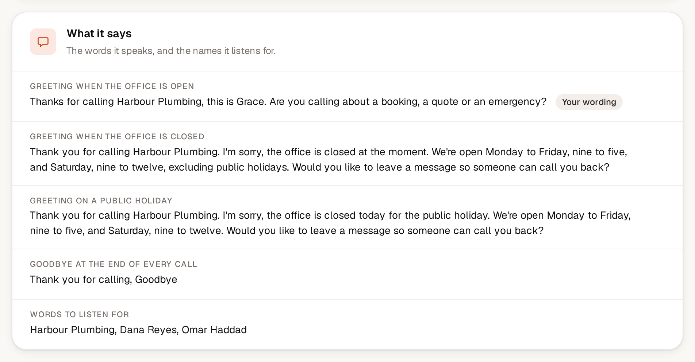
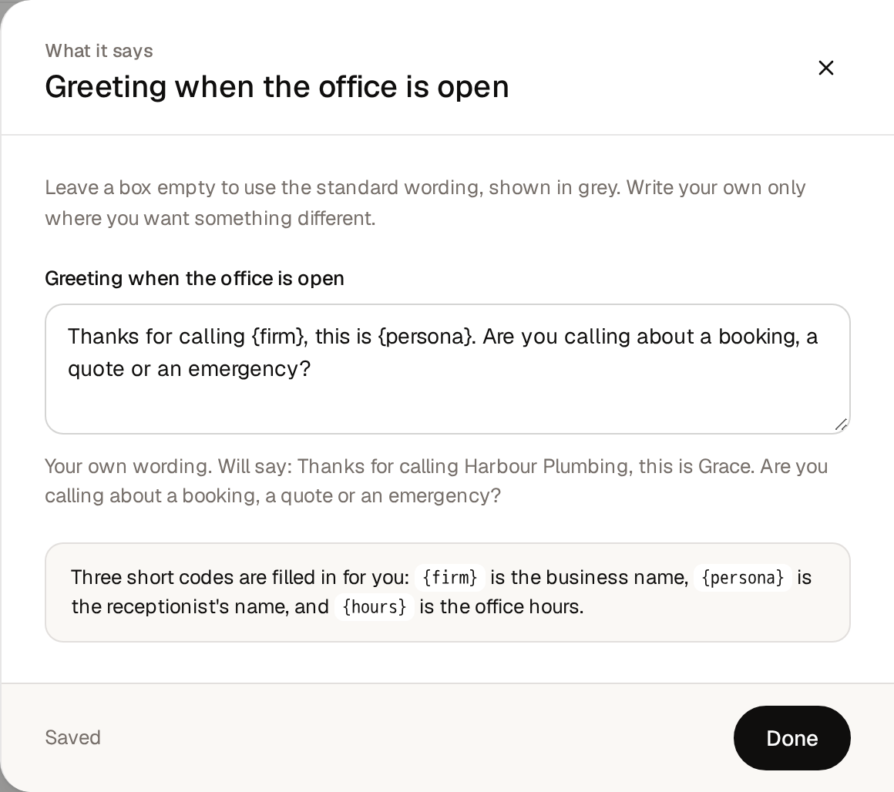
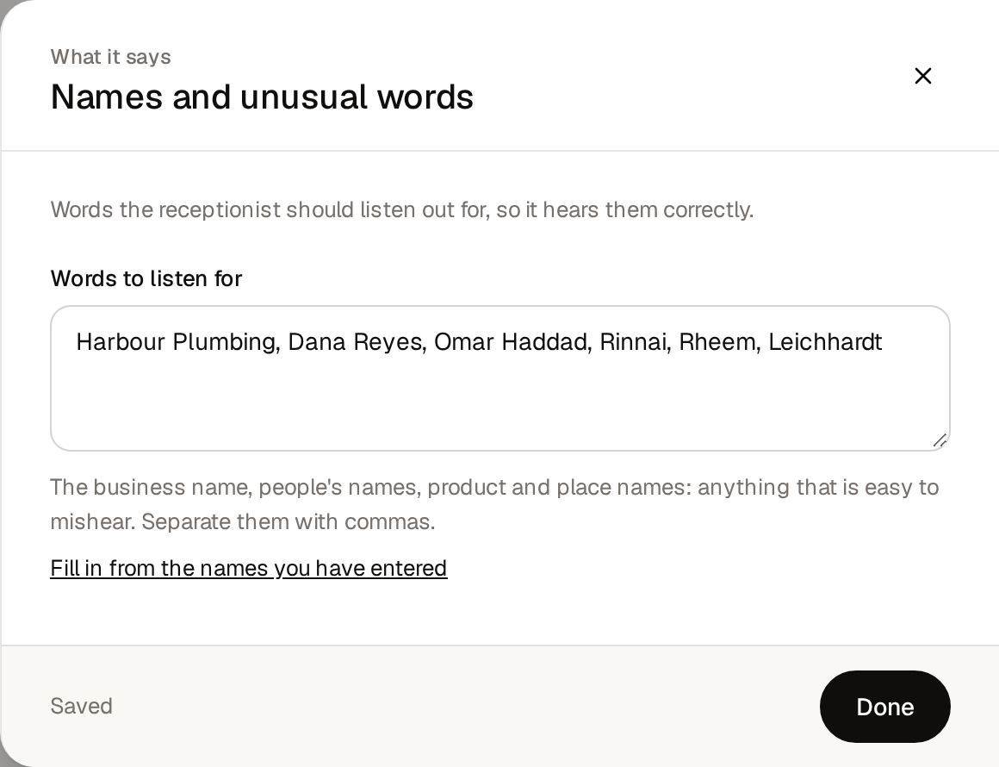

The **What it says** card holds the words your receptionist speaks at the start and end of a call, and the names it listens out for. Its line reads "The words it speaks, and the names it listens for."

You do not have to write anything here. Every line has standard wording that works for most businesses. Write your own only where you want something different.

<Frame>
  
</Frame>

## The rows

| What you see | When the caller hears it |
|---|---|
| **Greeting when the office is open** | When the receptionist answers during your office hours. |
| **Greeting when the office is closed** | When someone rings outside your office hours. |
| **Greeting on a public holiday** | When someone rings on one of your public holidays. |
| **Goodbye at the end of every call** | At the end of every call. |
| **Words to listen for** | Not spoken. Names and words the receptionist listens out for, so it hears them correctly. |

Each greeting row shows exactly what the caller will hear, with your business name, the receptionist's name and your hours filled in. A line you wrote yourself has a **Your wording** tag beside it. A line with no tag is the standard wording.

Your office hours and public holidays are set on the **Opening hours** card. See [Opening hours](/receptionist/opening-hours).

## The standard wording

This is what the receptionist says when you leave a line empty. Here it is for a business called Harbour Plumbing, with a receptionist called Ava, open Monday to Friday, nine to five:

| Line | Standard wording |
|---|---|
| **Greeting when the office is open** | "Thank you for calling Harbour Plumbing. This is Ava. How can I help you today?" |
| **Greeting when the office is closed** | "Thank you for calling Harbour Plumbing. I'm sorry, the office is closed at the moment. We're open Monday to Friday, nine to five, excluding public holidays. Would you like to leave a message so someone can call you back?" |
| **Greeting on a public holiday** | "Thank you for calling Harbour Plumbing. I'm sorry, the office is closed today for the public holiday. We're open Monday to Friday, nine to five. Would you like to leave a message so someone can call you back?" |
| **Goodbye at the end of every call** | "Thank you for calling, Goodbye" |

The standard wording follows your choices on the **Opening hours** card:

| Choice on the Opening hours card | The standard wording becomes |
|---|---|
| **During office hours**: **Put every call straight through** | Open greeting: "Thank you for calling Harbour Plumbing. I'll put you through now." |
| **Outside office hours**: **Say the greeting, then end the call** | Closed greeting: "You've reached Harbour Plumbing. The office is closed at the moment. We're open Monday to Friday, nine to five, excluding public holidays." |
| **On a public holiday**: **Say the greeting, then end the call** | Holiday greeting: "You've reached Harbour Plumbing. The office is closed today for the public holiday. We're open Monday to Friday, nine to five." |

The last two no longer ask the caller anything, because the call ends after them. A line you wrote yourself is never changed by these choices. See [Opening hours](/receptionist/opening-hours).

## Three short codes

You can use three short codes in any line. They are filled in for you each time:

| Code | Is replaced with | Example |
|---|---|---|
| `{firm}` | The business name from the **Your business** card | Harbour Plumbing |
| `{persona}` | The receptionist's name from the **Your business** card | Ava |
| `{hours}` | Your office hours, as the receptionist says them | Monday to Friday, nine to five |

Using the codes means your greetings stay right when you change the business name, the receptionist's name or your hours.

## Write your own wording

<Steps>
  <Step title="Open the line">
    Click the row on the **What it says** card. The panel says "Leave a box empty to use the standard wording, shown in grey. Write your own only where you want something different." If the box is empty, the standard wording shows in grey inside it.
  </Step>
  <Step title="Type what you want it to say">
    For example, for a dental practice: "Thanks for calling `{firm}`, this is `{persona}`. Are you calling to book, or about something else?" A line is a single line: pressing Enter does nothing.
  </Step>
  <Step title="Check the line under the box">
    It reads "Your own wording. Will say:" followed by exactly what the caller will hear, with the codes filled in.
  </Step>
  <Step title="Press Done">
    The row now shows your wording with the **Your wording** tag.
  </Step>
</Steps>

<Frame>
  
</Frame>

Callers hear your new wording only after you press **Go live** (or **Publish changes**). See [Go live](/receptionist/go-live).

### Rules for your own wording

- Up to 300 characters.
- One line, with no line breaks.
- In curly brackets, only `{firm}`, `{persona}` and `{hours}` can be used.

If a line breaks one of these rules, the row shows the problem in red and the receptionist cannot go live. For example: "The greeting is too long. Keep it to 300 characters or fewer."

### Tips the page may give

These show in amber. They do not stop the receptionist going live, but they are worth a look:

| Message | What it means |
|---|---|
| "The greeting does not end with a question, so callers may wait for the receptionist to carry on." | End the open-office greeting with a question, such as "How can I help you today?", so callers know it is their turn to speak. |
| "The closed greeting does not say when the office is open. Add `{hours}` where the opening hours should be said." | Add `{hours}` so callers know when to ring back. The same applies to the holiday greeting. |
| "The holiday greeting asks a question, but with "Say the greeting, then end the call" chosen the receptionist does not listen for an answer." | Your greeting asks the caller something, but the call ends after it. Remove the question, or change the choice on the **Opening hours** card. |

## Go back to the standard wording

<Steps>
  <Step title="Open the line">
    Click the row with the **Your wording** tag.
  </Step>
  <Step title="Empty the box">
    Delete everything in the box. The standard wording appears in grey, and the line under the box reads "Standard wording. Will say:" followed by the standard wording, with the short codes shown as they are rather than filled in.
  </Step>
  <Step title="Press Done">
    The **Your wording** tag is gone from the row.
  </Step>
</Steps>

## Words to listen for

This list helps the receptionist hear names and unusual words correctly when callers say them: your business name, your staff's names, products and place names. Anything easy to mishear belongs here.

For a vet clinic it might be: "Bayside Vets, Dr Nguyen, Priya, desexing, Manly".

<Steps>
  <Step title="Open the Words to listen for row">
    The panel is headed **Names and unusual words**.
  </Step>
  <Step title="Type the words, separated by commas">
    For example "Harbour Plumbing, Dana Reyes, Conveyancing". Pressing Enter does nothing.
  </Step>
  <Step title="Or press Fill in from the names you have entered">
    This adds your business name, the first word of your business name, and the name of every person and team on the **People and teams** card. Words already in the box stay.
  </Step>
  <Step title="Press Done">
    The row shows the list.
  </Step>
</Steps>

<Frame>
  
</Frame>

A new receptionist starts with the business name in this list. Add to it whenever you add people or teams.

The list cannot be empty. If it is, the row says "Add at least one name or word callers are likely to say, such as a staff name. It helps the receptionist hear it correctly." and the receptionist cannot go live.

If you made the receptionist from your website, this row may carry a **From your website** tag. Check the words, then press **These look right** on the card. See [Create a receptionist](/receptionist/create#check-what-was-filled-in).

## When the card is locked

If "Your provider has locked this." shows beside the card's title, its rows cannot be opened. See [Access and locks](/workspace/access-and-locks).

## Common questions

<AccordionGroup>
  <Accordion title="I changed my opening hours. Do I need to change my greetings?">
    Not if your greetings use `{hours}`, as the standard wording does. The new hours are filled in for you. If you typed the hours into your own wording, change them by hand.
  </Accordion>
  <Accordion title="Can I change what the receptionist says in the middle of a call?">
    Not on this card. It holds the greetings, the goodbye and the words to listen for. What the receptionist knows to answer questions is on the **What it knows** card. See [What it knows](/receptionist/what-it-knows).
  </Accordion>
  <Accordion title="Why does the closed greeting row show different words from what I typed?">
    The row shows what the caller will hear, with `{firm}`, `{persona}` and `{hours}` filled in.
  </Accordion>
</AccordionGroup>
