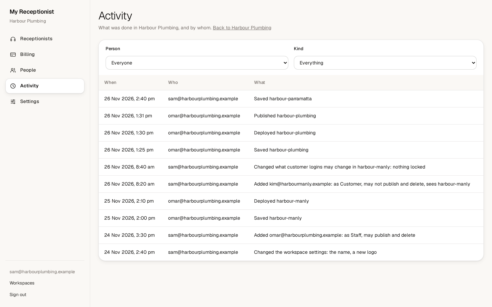
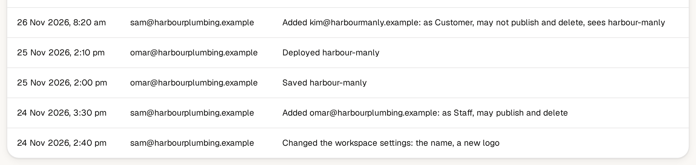
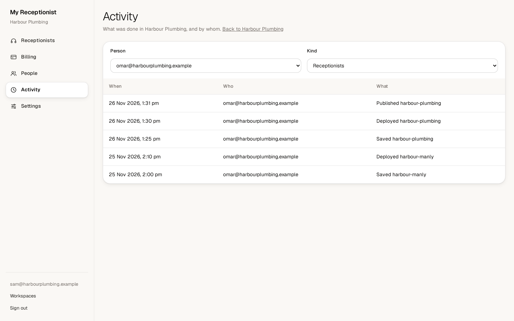

The **Activity** page is the record of who did what in your workspace. If a caller tells you the receptionist suddenly started giving the wrong opening hours, this is where you can see who changed the receptionist, and when.

Only an **Owner** can see the **Activity** page. It appears in the side menu for owners only.

<Frame>
  
</Frame>

## What each line shows

The page lists what happened, newest first. Each line has three columns:

| Column | What it shows |
|---|---|
| **When** | The date and time, shown in your own computer's time zone. |
| **Who** | The email address of the person who did it. **The system** when nobody signed in did it. |
| **What** | One plain sentence saying what was done. |

Simply looking at a page is not recorded. The exceptions are opening a call on the **Calls** page and playing or downloading its recording, which are recorded.

## What is recorded

These are the kinds of things you will see, with examples of the words on the page.

| Kind | Examples of what you see under **What** |
|---|---|
| **Receptionists** | "Added receptionist" and the receptionist. "Saved" and the receptionist, with the number of saves when there were several, for example "(12 saves)". "Deployed", "Asked to publish", "Published", "Deleted". "Read the website for" the receptionist. "Changed what customer logins may change in" the receptionist. |
| **People and emails** | "Added" a person, with their role, for example "as Customer, may not publish and delete". "Changed" a person. "Removed" a person "from the workspace". "Emailed" a person "an invitation". "Accepted the invitation". "The email to" a person "could not be sent". |
| **Workspace settings and keys** | "Changed the workspace settings", with what changed, for example "the name, a new logo". "Set the email key" and similar lines about the keys the workspace uses. |
| **Call history** | "Opened a call of" a receptionist. "Played or downloaded the recording of a call of" a receptionist. |
| **Billing** | "Opened the payments page to manage billing". |

A receptionist is named in these lines by its **Short name**, the one chosen when it was made, for example "Saved bayside-dental". This is not the name shown in your list.

<Frame>
  
</Frame>

The receptionist's page saves by itself as someone makes changes. So that this does not fill the page, saves by one person to one receptionist are shown as one line, with the number of saves in brackets. The line keeps counting while the saves come within 15 minutes of each other.

## Filter the list

Two lists at the top narrow what is shown. Choosing from either shows the first page of the matching lines.

<Steps>
  <Step title="Choose a person">
    Under **Person**, choose someone's email address to see only what they did. Choose **Everyone** to see everyone again.
  </Step>
  <Step title="Choose a kind">
    Under **Kind**, choose **Receptionists**, **People and emails**, **Workspace settings and keys**, **Call history** or **Billing**. Choose **Everything** to see every kind again.
  </Step>
</Steps>

You can use both together, for example to see only what one staff member did to receptionists.

<Frame>
  
</Frame>

## Moving through the pages

The page shows 50 lines at a time. When there are more, the bottom of the list shows "Page 1 of" the number of pages, with **Older** to go back further and **Newer** to come forward again.

If nothing has been recorded yet, or nothing matches your filters, the list says "Nothing yet."

## What is not on this page

- Signing in and out, and password and two-step sign-in changes, are not shown here. They belong to each person's account, not to the workspace.
- The record does not show the internet address a person used.

## How long it is kept

Lines are not removed from the record, and nobody can change them. The only thing that changes is the count on a **Saved** line while saves keep coming.

## Common questions

<AccordionGroup>
  <Accordion title="Can Staff see the Activity page?">
    No. Only an Owner can.
  </Accordion>
  <Accordion title="Can I delete a line?">
    No. The record cannot be changed or deleted from the page.
  </Accordion>
  <Accordion title="Why does one line say there were many saves?">
    The receptionist's page saves by itself as someone makes changes. Saves by one person to one receptionist, each within 15 minutes of the last, are grouped into one line, with the number of saves in brackets.
  </Accordion>
</AccordionGroup>
