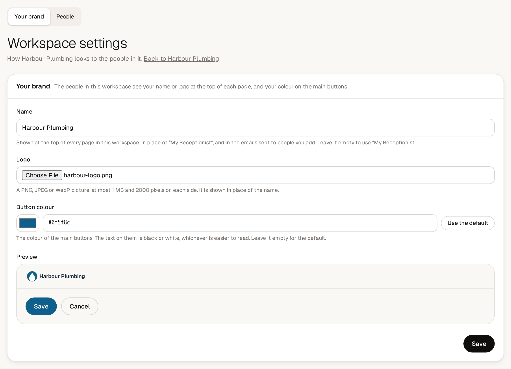
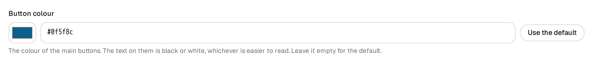
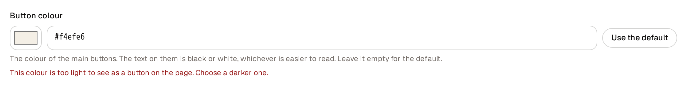

You can put your own name, logo and button colour on the pages people see in your workspace. For example, a company that runs receptionists for several medical practices can show its own name and colour to everyone who signs in.

This is set on the **Settings** page, which only an **Owner** can see. It appears in the side menu for owners only. **Settings** has two tabs at the top: **Your brand**, which opens first, and **People**, for who can sign in (see [People and roles](/workspace/people-and-roles)). The **Your brand** tab is headed **Workspace settings** and its card is **Your brand**: "The people in this workspace see your name or logo at the top of each page, and your colour on the main buttons."

Branding changes how the pages look to people who sign in. It does not change anything a caller hears.

<Frame>
  
</Frame>

## What you can set

| What you see | What it does |
|---|---|
| **Name** | Shown at the top of every page in this workspace, in place of "My Receptionist", and in the emails sent to people you add. Leave it empty to use "My Receptionist". |
| **Logo** | A picture shown at the top of every page in place of the name. |
| **Button colour** | The colour of the main buttons. The text on them is black or white, whichever is easier to read. Leave it empty for the default. |

The **Preview** beside the boxes shows the top of the page and two buttons as they will look, before you save.

## Change your branding

<Steps>
  <Step title="Open Settings">
    In the side menu, click **Settings**. The **Your brand** tab opens.
  </Step>
  <Step title="Type a name">
    Type your name in **Name**. It can be up to 60 characters.
  </Step>
  <Step title="Add a logo">
    Under **Logo**, choose a picture file from your computer. To take a logo away, tick **Remove the logo** instead.
  </Step>
  <Step title="Choose a button colour">
    Under **Button colour**, click the colour square to pick a colour, or type a colour code such as #1d4f91 in the box beside it. Click **Use the default** to go back to the standard colour.
  </Step>
  <Step title="Check the preview">
    Look at the **Preview** to see how it will look.
  </Step>
  <Step title="Save">
    Click **Save**. The page says "Workspace settings saved."
  </Step>
</Steps>

<Frame>
  
</Frame>

## Limits

### Name

- At most 60 characters, on one line.
- Letters, numbers, spaces and these marks only: & ' . , - + ! ?
- It cannot look like a web or email address. For example, "Harbour Legal" is fine, but "harbourlegal.com.au" is refused.

### Logo

- A PNG, JPEG or WebP picture. Other kinds, including SVG, are refused.
- At most 1 MB.
- At most 2000 pixels wide and 2000 pixels high.

### Button colour

- A colour code: # followed by six digits or letters from A to F, like #1d4f91.
- It must be dark enough to stand out against the page's light background. A very light colour, such as a pale yellow or a pale grey, is refused, because a button in that colour would be hard to see.

<Frame>
  
</Frame>

## Messages you may see

| Message | What to do |
|---|---|
| "Use only letters, numbers, spaces and these marks in the name: & ' . , - + ! ?" | Take out any other marks, such as brackets, slashes, @ or #. |
| "The name cannot look like a web or email address." | Use your business name without the web address. |
| "The name can be at most 60 characters." | Shorten the name. |
| "The logo must be a PNG, JPEG or WebP picture." | Save the picture in one of those kinds, then try again. |
| "The logo can be at most 1 MB." | Use a smaller file. |
| "The logo can be at most 2000 pixels wide and 2000 pixels high." | Make the picture smaller. |
| "Logos cannot be uploaded at the moment. Try again later." | Try again later. If it keeps happening, contact support. |
| "Type # and six digits or letters from A to F, like #1d4f91." (while you type), or "Type the colour as # and six digits or letters from A to F, like #1d4f91." (after you save) | Check the colour code. It needs the # and exactly six characters. |
| "The name must be on one line." | Take out any line breaks in the name. |
| "This colour is too light to see as a button on the page. Choose a darker one." | Choose a darker colour. |

## Where your branding shows

- At the top of the side menu on every page inside the workspace: your logo if you added one, otherwise your name.
- On the main buttons on those pages, in your colour.
- In the browser tab's title on those pages.
- In the emails sent when you add someone on the [People](/workspace/people-and-roles) tab.

It does not show on the sign-in page, on the page where someone chooses between workspaces, or on a person's own account page. Those keep the standard My Receptionist look.

## Common questions

<AccordionGroup>
  <Accordion title="Who can change the branding?">
    Only an Owner of the workspace.
  </Accordion>
  <Accordion title="Can I use an SVG logo?">
    No. Use a PNG, JPEG or WebP picture.
  </Accordion>
  <Accordion title="I added a logo. Why don't I see the name any more?">
    The logo is shown in place of the name. To show the name again, tick **Remove the logo** and save.
  </Accordion>
  <Accordion title="How do I go back to the standard look?">
    Empty the **Name** box, tick **Remove the logo**, click **Use the default** under **Button colour**, then click **Save**.
  </Accordion>
</AccordionGroup>
