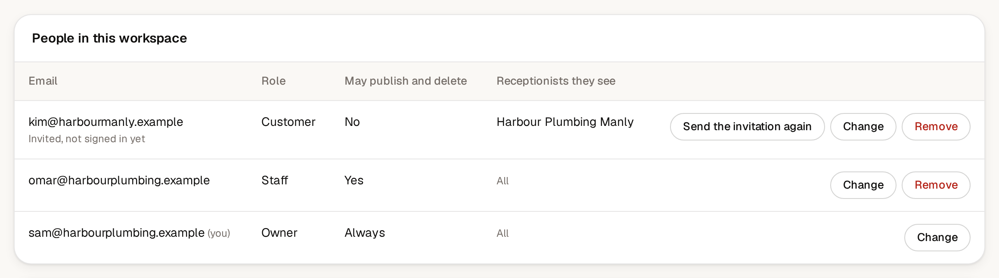
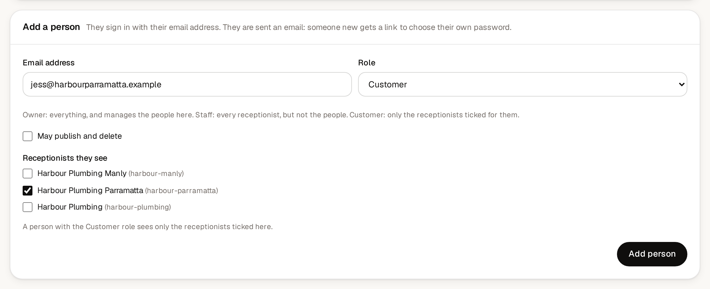
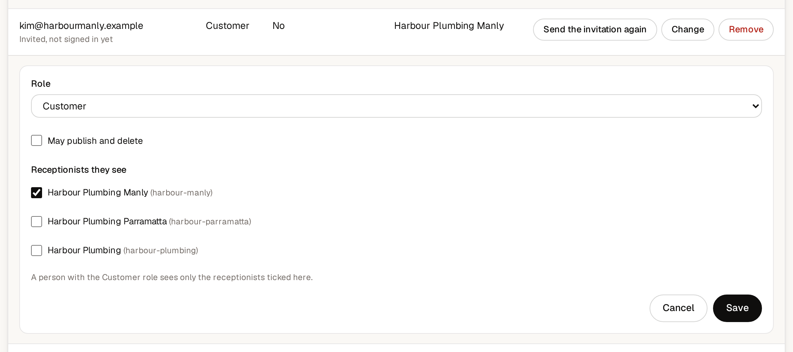

The **People** page decides who can sign in to your workspace and what each of them can do. For example, a dental practice owner can let the practice manager edit the receptionist's opening hours, without letting her see billing.

<Note>
**People** in the side menu is about the people who **sign in** to My Receptionist. It is not the same as **People and teams** on a receptionist's page, which is the list of people and teams **callers** can be put through to. For that, see [People and teams](/receptionist/people-and-teams).
</Note>

Only an **Owner** can see the **People** page. It appears in the side menu for owners only.

<Frame>
  
</Frame>

## The roles

Each person has one role in the workspace: **Owner**, **Staff** or **Customer**. The page sums them up as: "Owner: everything, and manages the people here. Staff: every receptionist, but not the people. Customer: only the receptionists ticked for them."

Staff and Customer people can also be given the **May publish and delete** tick. An Owner can always publish and delete. For a Customer, the tick lets them make changes live, but never delete a receptionist.

| What they can do | Owner | Staff | Customer |
|---|---|---|---|
| See receptionists | Every one | Every one | Only the ones ticked for them |
| Add a new receptionist | Yes | Yes | No |
| Change a receptionist's set-up | Yes | Yes | Only their own, and not the parts that are locked |
| Make changes live with **Go live** | Yes | With the tick | Their own, with the tick |
| Delete a receptionist | Yes | One that has never gone live: yes. One that has: with the tick | No |
| Choose the phone number | Yes | Yes | No: they see the number, but cannot change it |
| Get a new phone number | Yes | No | No |
| Choose or create a knowledge base | Yes | Yes | No: they can add to and remove from the one their receptionist uses, unless that part is locked |
| See calls on the **Calls** page | Every receptionist's | Every receptionist's | Only their own receptionists' |
| **Billing**, **People**, **Activity**, **Settings** | Yes | No | No |

A person without the tick can still make changes, and their changes are saved. When they try to make them live, they are told: "Your changes are saved, but your account is not allowed to make them live. Ask someone who can go live to press Go live."

The **Customer** role is for a business whose receptionist is looked after by someone else. For example, an IT company that runs receptionists for several law firms can give each firm's office manager a Customer login that shows only that firm's receptionist. To stop a Customer changing certain parts, see [Access and locks](/workspace/access-and-locks).

## The list of people

The **People in this workspace** card lists everyone, sorted by email address. Each line shows:

| Column | What it shows |
|---|---|
| **Email** | Their email address. Your own line says **(you)**. Someone who has not signed in yet shows **Invited, not signed in yet**. |
| **Role** | **Owner**, **Staff** or **Customer**. |
| **May publish and delete** | **Always** for an Owner, otherwise **Yes** or **No**. |
| **Receptionists they see** | **All** for Owner and Staff. For a Customer, the names of their receptionists, or **None yet**. |

## Add a person

<Steps>
  <Step title="Open People">
    In the side menu, click **People**.
  </Step>
  <Step title="Type their email address">
    In the **Add a person** card, type their address in **Email address**. They will sign in with this address.
  </Step>
  <Step title="Choose a role">
    Choose **Owner**, **Staff** or **Customer** under **Role**.
  </Step>
  <Step title="Choose what else they may do">
    For Staff or Customer, tick **May publish and delete** if they should be able to make changes live and delete receptionists. For a Customer, tick the receptionists they should see under **Receptionists they see**.
  </Step>
  <Step title="Press Add person">
    Click **Add person**. The page says, for example, "sam@example.com added. They have been sent an email."
  </Step>
</Steps>

<Frame>
  
</Frame>

### What the person receives

- **Someone new to My Receptionist** gets an email with the subject "You have been added to" and your workspace's name. It has a **Choose your password** button. The email says "The link works once, for 7 days." The link opens a page where they choose a password, type it again, and press **Save the password and sign in**. Where it is set up, they can use their Google or Microsoft account instead. See [Sign in](/get-started/sign-in).
- **Someone who already has an account** gets an email saying they have been added, with a button to open the workspace. They sign in with their usual email address and password.

The page shows you the same message in both cases. It does not tell you whether the address already had an account.

If the link has already been used or is more than 7 days old, the page it opens says "This link has already been used or has expired." Send the invitation again (below).

## Send the invitation again

While a person shows **Invited, not signed in yet**, their line has a **Send the invitation again** button. Click it to send a fresh email. The page says "The email to" their address "has been sent again." A new invitation replaces the old one, so only the newest link works.

If an email could not be sent, their line says "The email to" their address "could not be sent." For someone who has not signed in yet, click **Send it again.** beside it.

**Invited, not signed in yet** goes away once they have opened the workspace.

## Cancel an invitation

To cancel an invitation, remove the person (below). If they were new to My Receptionist and are in no other workspace, the account made for them is deleted too.

## Change a person's role

<Steps>
  <Step title="Press Change">
    On the person's line, click **Change**. Their settings open under the line.
  </Step>
  <Step title="Make the change">
    Choose a new **Role**, tick or untick **May publish and delete**, and for a Customer tick their receptionists.
  </Step>
  <Step title="Save">
    Click **Save**. The page says their address followed by "saved." Click **Cancel** to close without saving.
  </Step>
</Steps>

<Frame>
  
</Frame>

The change counts from the next page they open. You do not need to ask them to sign out.

If you change a Customer to Owner or Staff, the list of receptionists ticked for them is cleared, because Owner and Staff see every receptionist.

## Remove a person

<Steps>
  <Step title="Press Remove">
    On the person's line, click **Remove**.
  </Step>
  <Step title="Confirm">
    Your browser asks "Take" their address "out of" your workspace's name, followed by "Their account stays." Accept it to go ahead.
  </Step>
</Steps>

The page says their address followed by "removed from this workspace." They can no longer open this workspace. Their account stays, so they can still sign in to any other workspace they belong to.

## Rules that protect the workspace

| Message | Why |
|---|---|
| "You cannot change your own role." | Another Owner must change it for you. |
| "You cannot remove yourself from this workspace." | Your own line has no **Remove** button. Another Owner must remove you. |
| "A workspace must keep at least one owner." | You cannot remove the last Owner, or change their role. Make someone else an Owner first. |
| "This person is already in this workspace." | The address is already on the list. Use **Change** instead. |
| "That is not an email address." | Check the address you typed. |
| "Too many invitations just now. Try again later." | Too many people have been added, or too many emails sent to one address, in a short time. Wait and try again. |

## Common questions

<AccordionGroup>
  <Accordion title="Can I set a password for someone?">
    No. Nobody can set a password for another person. The person chooses their own from the emailed link.
  </Accordion>
  <Accordion title="Can a workspace have more than one Owner?">
    Yes. Choose **Owner** as the role when you add or change someone.
  </Accordion>
  <Accordion title="Does removing someone delete their account?">
    No, their account stays. The one exception is someone who was invited, never signed in, and is in no other workspace: their unused account is deleted.
  </Accordion>
  <Accordion title="Can a person have a different role in another workspace?">
    Yes. Roles are set workspace by workspace. See [Several workspaces](/workspace/several-workspaces).
  </Accordion>
</AccordionGroup>
