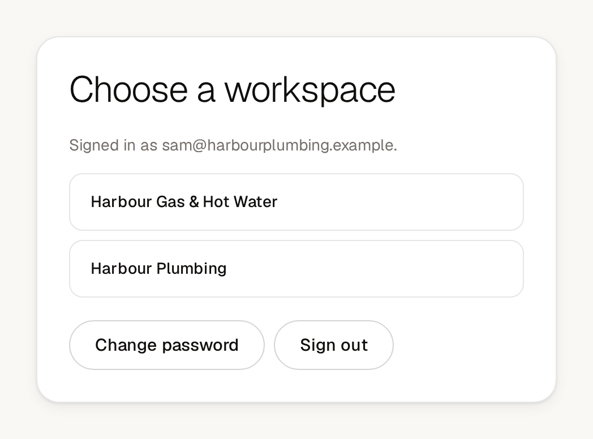
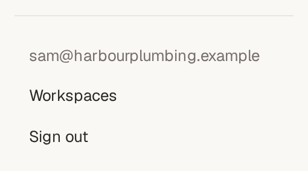

One email address can belong to more than one workspace. For example, a bookkeeper might help both a dental practice and a plumbing business, each with its own workspace. She signs in once with the same email address and password, then chooses which business to work in.

Each workspace is kept apart. Its receptionists, people, billing and branding are its own.

## After you sign in

What you see after signing in depends on how many workspaces you belong to:

| You belong to | What happens |
|---|---|
| One workspace | You go straight into it. |
| More than one | You see the **Choose a workspace** page. |
| None | You see **No access**: "You are signed in as" your email address, "That account has no access here. Ask whoever gave you this address to add you." |

<Frame>
  
</Frame>

The **Choose a workspace** page says "Signed in as" and your email address, then lists your workspaces by name. Click a name to open that workspace.

The page also has **Change password** and **Sign out** buttons.

## Move to another workspace

<Steps>
  <Step title="Click Workspaces">
    At the bottom of the side menu, under your email address, click **Workspaces**. This link shows only when you belong to more than one workspace.
  </Step>
  <Step title="Choose the workspace">
    On the **Choose a workspace** page, click the workspace you want.
  </Step>
</Steps>

<Frame>
  
</Frame>

You stay signed in while you move between workspaces. The name of the workspace you are in shows at the top of the side menu, under the brand.

## Your role in each workspace

Your role is set separately in each workspace. You might be an **Owner** in one and **Staff** or **Customer** in another. The **May publish and delete** tick, and which receptionists a Customer sees, are also set workspace by workspace.

So the side menu can look different from one workspace to the next. For example, **Billing** and **Settings** show only in a workspace where you are an Owner. See [People and roles](/workspace/people-and-roles).

Each workspace can also have its own name, logo and button colour, so the pages can look different too. See [Branding](/workspace/branding).

## Being added to another workspace

When an Owner of another workspace adds your email address, you get an email saying you have been added, with a button to open it. Sign in with your usual email address and password. The new workspace then appears on your **Choose a workspace** page.

Being added to a workspace never changes your password.

## Leaving a workspace

You cannot remove yourself from a workspace. Ask an Owner of that workspace to remove you on its **People** page. Your account stays, and you keep your other workspaces.

If you open the address of a workspace you no longer belong to, you see **No access**.

## Common questions

<AccordionGroup>
  <Accordion title="Do I need a different password for each workspace?">
    No. One email address and password works for all your workspaces.
  </Accordion>
  <Accordion title="Can people in one workspace see my other workspaces?">
    No. Each workspace sees only its own receptionists, people and records.
  </Accordion>
  <Accordion title="Why don't I see Workspaces in the side menu?">
    It shows only when you belong to more than one workspace.
  </Accordion>
  <Accordion title="Why can I see Billing in one workspace but not another?">
    Billing shows only where you are an Owner. Your role is set separately in each workspace.
  </Accordion>
</AccordionGroup>
